<!-- PDF page 1 -->

# Vitalia: App Design Document

**Project: Social assistance robot for older adults**

- Iván Vayad Díaz (874762)
- Lucía Vázquez Martín (871886)
- Luna Zhou Chen (812103)

**Group 1**

**Universidad de Zaragoza (University of Zaragoza)**

**Course:** Diseño centrado en el usuario. Diseño para la multimedia [User-centred design. Design for multimedia] [30258]

**Academic year:** 2025/26

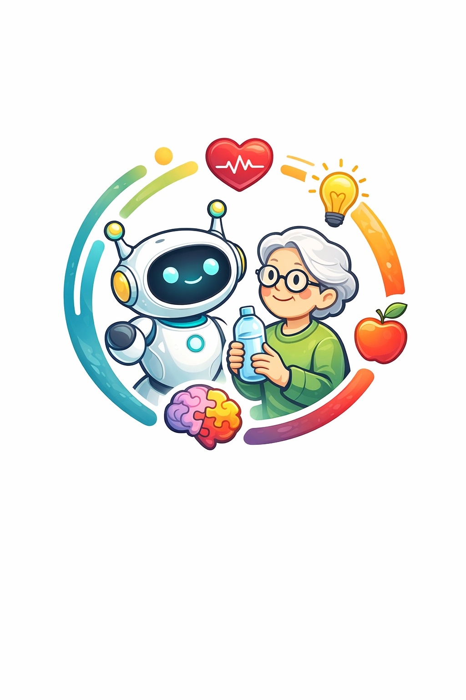

*Figure: Cover illustration showing a friendly white robot next to a smiling older woman holding a bottle of water, framed by a colourful circle with icons of a heart with a heartbeat line, a light bulb, an apple and a puzzle-piece brain, representing health, ideas, healthy habits and cognitive stimulation.*

*English translation of the original Spanish document [documento_diseno_vitalia.pdf](documento_diseno_vitalia.pdf). The Spanish original is authoritative.*

## Contents

- [1. GENERAL INFORMATION](#1-general-information)
    - [1.1. App summary](#11-app-summary)
    - [1.2. Project objectives](#12-project-objectives)
    - [1.3. Project rationale](#13-project-rationale)
    - [1.4. Main functionality](#14-main-functionality)
    - [1.5. App features](#15-app-features)
- [2. USER RESEARCH](#2-user-research)
    - [2.1. Information gathering](#21-information-gathering)
    - [2.2. User profile / Personas](#22-user-profile--personas)
    - [2.3. Usage scenarios](#23-usage-scenarios)
    - [2.4. User Journey Map](#24-user-journey-map)
- [3. SYSTEM REQUIREMENTS](#3-system-requirements)
    - [3.1. Functional requirements](#31-functional-requirements)
    - [3.2. Non-functional requirements](#32-non-functional-requirements)
- [4. ARCHITECTURE AND INTERACTION DESIGN](#4-architecture-and-interaction-design)
    - [4.1. Navigation structure](#41-navigation-structure)
    - [4.2. Wireframes and prototypes](#42-wireframes-and-prototypes)
    - [4.3. User interface](#43-user-interface)
    - [4.4. Controls and interactions](#44-controls-and-interactions)
- [5. MARKETING AND ADVERTISING](#5-marketing-and-advertising)
    - [5.1. Promotional screenshots / icon](#51-promotional-screenshots--icon)
    - [5.2. Promotional video](#52-promotional-video)
    - [5.3. Demo](#53-demo)
- [6. LIMITATIONS AND CONSTRAINTS](#6-limitations-and-constraints)
- [7. UX AND ACCESSIBILITY](#7-ux-and-accessibility)
    - [7.1. Usability principles](#71-usability-principles)
    - [7.2. Accessibility](#72-accessibility)
    - [7.3. UX evaluation](#73-ux-evaluation)
- [8. DOCUMENT INFORMATION](#8-document-information)
    - [8.1. Definitions, acronyms and abbreviations](#81-definitions-acronyms-and-abbreviations)
    - [8.2. References](#82-references)
    - [8.3. Attached files](#83-attached-files)
- [9. PLANNING AND RESOURCES](#9-planning-and-resources)
    - [9.1. Project schedule](#91-project-schedule)
    - [9.2. Organisation of the work into sprints or blocks](#92-organisation-of-the-work-into-sprints-or-blocks)
    - [9.3. Team members' roles](#93-team-members-roles)
    - [9.4. Resources used](#94-resources-used)
    - [9.5. Difficulties and mistakes during development](#95-difficulties-and-mistakes-during-development)
- [10. BIBLIOGRAPHY](#10-bibliography)
- [11. ANNEXES](#11-annexes)
    - [11.1. Annex I. Report for practical assignment 1](#111-annex-i-report-for-practical-assignment-1)
    - [11.2. Annex II. Report for practical assignment 2](#112-annex-ii-report-for-practical-assignment-2)
    - [11.3. Annex III. Information gathering](#113-annex-iii-information-gathering)

<!-- PDF page 4 -->

## 1. GENERAL INFORMATION

### 1.1. App summary

The **app developed** for the Sanbot ELF social robot has the **main purpose** of helping older adults who live alone to keep a more organised and active daily routine. The proposal combines reminders, activity management and short cognitive-stimulation games within a single interface, accessible from the robot's screen and supported by its voice and physical presence.

The **problem it aims to address** is the appearance of periods of the day with little structure, low activity and few stimuli, together with occasional forgetting of everyday tasks. **Compared with other technological solutions** that depend on the user always taking the initiative, this app relies on a robot capable of issuing reminders and accompanying the interaction from within the home environment itself. In this way, the app is not limited to displaying information, but acts as support for following the routine, taking part in short games and maintaining a more continuous interaction with the system.

The app is **aimed mainly at independent older adults** who live alone and who can benefit from a daily support tool integrated into a social robot. **Secondarily**, it can also give peace of mind to family members or people close to them who want the user to have everyday help that reinforces activity, organisation and companionship.

### 1.2. Project objectives

The **general objective** of the project is to **develop an app for the Sanbot ELF social robot** that helps older adults who live alone to organise their daily routine, maintain activity habits and receive short cognitive stimuli through an interaction adapted to their abilities and context of use. This objective is approached from a **User-Centred Design perspective**, which means that decisions on structure, interaction and visual design are made on the basis of needs identified in real users and not solely on technical criteria.

From the **user's** point of view, the project pursues several **specific objectives**:

- The aim is to **offer** direct access to relevant everyday functions, avoiding long paths through the app and concentrating navigation on a small number of main screens.
- The aim is **for each action** to be quickly identifiable through large buttons, icons associated with everyday tasks, short messages and a visual layout that clearly separates each functional block.
- The aim is to **introduce** reminders and short activities that help reduce prolonged moments of inactivity without demanding sustained effort or a high cognitive load.

<!-- PDF page 5 -->

- The aim is **for the user** to perceive the robot not only as a functional device, but also as an everyday support that provides companionship and continuity throughout the day.

From the point of view of **the institution or the development team**, the project also pursues **concrete objectives**:

- The aim is to **validate** a technologically viable proposal on the Sanbot ELF platform, making use of resources already available on the robot, such as the touchscreen, voice, reminders and basic brightness and volume settings.
- The aim is to **build** a modular app foundation that allows the system to be extended in future phases without rebuilding the main structure.
- The aim is to **demonstrate** that a solution focused on the everyday wellbeing of older adults can be designed coherently when user research, the real constraints of the device and an iterative implementation approach are combined.

### 1.3. Project rationale

This project is **relevant** because it **addresses an everyday situation** that is not always well covered by conventional technological solutions: the periods of inactivity, disorganisation and lack of stimulation that can arise in older adults who live alone. In this context, it is not enough for a tool to exist or to have many functions; it must also **fit into the daily routine** without requiring the user to constantly remember how to use it or to always have to start the interaction themselves.

The proposal **meets this need** through an app designed to accompany the user's day-to-day life from the robot itself, combining basic organisation, reminders and short activities. Its **main contribution** lies not in adding complex functions, but in bringing together in a single solution concrete actions that make sense in the home and that can be presented in a guided, gradual and visible way on screen. In this way, the user has an everyday support that is not limited to displaying information, but takes part in the daily dynamic.

Compared with other similar solutions, the project's **differentiating value** lies in the active role of the robot in the interaction. The proposal is not conceived as a conventional mobile app or as an assistant that only responds when called upon, but as a system that can take the initiative within defined limits and that uses its physical presence as part of the experience. This difference is important because it means the interaction does not depend exclusively on menus, notifications or commands, but also on the continuous presence of the device in the home environment.

The project **will meet the defined objectives** through a design centred on concrete and frequent actions: accessing the day's routine, managing reminders and carrying out short stimulation activities. The rationale for the project, therefore, is not based on incorporating many features, but on developing a solution consistent with the context of use, the user profile and the type of support to be offered.

<!-- PDF page 6 -->

### 1.4. Main functionality

The **main functionality of the app** is to allow the user to follow and manage a daily routine supported by the robot. Through the **interface**, the user can check which activities are scheduled, receive alerts at the right moment and take part in short interactions proposed by the system. The app is therefore organised around a very specific **usage sequence**: see what needs to be done, understand the requested action and respond to it there and then.

This main functionality translates into an experience centred on **short, immediately executed actions**. Instead of proposing long sessions or complex paths within the app, the system presents each task as a **concrete unit of interaction**: a reminder, a short activity or a simple game. In this way, the user does not need to plan all their use of the app themselves, but instead finds in it a support that structures the day through small, recognisable steps.

The **essential function**, therefore, is not to store information or to offer a large number of options, but to **accompany** the user in their daily routine through one-off interactions that appear when it is time to carry them out. This allows the app to act as a daily point of support, combining consultation, follow-up and participation in activities within a single usage logic.

### 1.5. App features

This section brings together the **most relevant features** of the app, understood as those elements that define its structure, its form of interaction and its usefulness within the project. The purpose is to **provide an overview** of the proposal before detailing more specific aspects in the following subsections.

- **Organisation into clearly differentiated functional blocks.** The app is structured into main sections such as Activities, Reminders, Games and Settings. This division allows each screen to have a specific function and the user to quickly identify where to go depending on the action they want to perform.
- **Main screen as the access hub.** The home screen is used as the central point from which the day's routine is displayed and the rest of the functions are accessed. In this way, the user finds an overview of their day and direct shortcuts without needing to go through several menus.
- **Integrated routine support and reminders.** The tool is geared towards everyday organisation, allowing the user to check activities and maintain a structure for the day. To this end, it incorporates reminders about habits or specific tasks that work dynamically within the robot's system, going beyond the concept of a static list.
- **Short stimulation games.** The proposal includes simple mini-games (Sayings (Refranes), Seek and Find, Mini-Rosco (word wheel) and Bingo) designed to introduce short moments of participation and cognitive stimulation, without demanding long sessions or complex rules.

<!-- PDF page 7 -->

- **Guided interaction and immediate feedback.** The robot takes an active part through messages and visual speech bubbles. After each action, the system provides a clear visual response or closing screens, which gives continuity to the experience and ensures that the user understands the result of their interaction.
- **Touch interface adapted to the device.** The app has been designed specifically for the Sanbot ELF screen, using large buttons, wide tappable areas and a layout designed for direct and comfortable touch interaction.
- **Visual consistency across screens.** All screens follow the same graphic logic (top banner, consistent use of colours and button styles). This continuity reduces the feeling of abrupt change and makes it easier to learn the navigation.
- **Simple navigation system.** The architecture is based on few levels and direct transitions. Secondary screens include a top banner with a back arrow, allowing the user to go back without losing track of where they are.
- **Integrated basic system settings.** The app allows basic device parameters, such as volume or brightness, to be controlled from its own section. In this way, the user can adapt the environment without having to leave the general logic of the app.

#### 1.5.1. Type of application

The app can be classified mainly as an **everyday support app with a social component**, although it also incorporates functions typical of personal organisation and cognitive entertainment. This classification has been chosen because its main purpose is not only to display information, manage tasks or entertain the user in isolation, but to accompany them in their day-to-day life through a combination of reminders, short activities and moments of interaction with the robot.

This choice is justified because **the need the project responds to** is not a single one, but spans several interrelated areas. On the one hand, the app helps to structure the daily routine and reinforce basic habits. On the other, it introduces small games and interactions that provide stimulation and variety at times of low activity. In addition, the fact that it is developed on a social robot adds an element of companionship that is not usually present in conventional apps focused solely on productivity or entertainment. For this reason, the proposal does not fit entirely into a single traditional category, but sits somewhere between everyday assistance, organisational support and social companionship.

#### 1.5.2. Target platform

The target platform of the app is **Android**, within the runtime environment of the **Sanbot ELF** robot. This choice is due, first of all, to the fact that the project was not conceived as an app for various devices, but as a solution designed to **run directly on the robot** with which the end user will interact. For

<!-- PDF page 8 -->

this reason, the platform is not chosen merely for technical convenience, but because it coincides with the actual hardware on which the app will be used.

Furthermore, developing for Android in this context makes it possible to work in an environment already integrated into the device and to make use of resources available on the robot itself, such as the touchscreen, voice control, system reminders and certain basic usage settings. This allows the app to adapt better to the real conditions of interaction and avoids designing a proposal that, although it might be valid in the abstract, would not then fit in with the actual operation of the Sanbot ELF.

#### 1.5.3. Required technologies

Various tools have been used to design and develop the app, each with a specific function within the project.

In the design phase, the app Mockup - UI/UX Design, available on the App Store, was used. This tool made it possible to create visual prototypes of the screens before starting implementation, defining the layout of buttons, text, games and navigation paths. Using it proved helpful for visualising the structure of the app in advance and checking whether the organisation of the elements was coherent before carrying it over into the final development.

In the implementation phase, Android Studio has been used as the main development environment. This tool was chosen because the app is intended for the Android environment of the Sanbot ELF robot and it allows the project structure, the screens, the graphic resources and the interaction logic to be managed in an integrated way.

Java has been used as the programming language, while the visual interface of the screens has been defined using XML layouts. This combination makes it possible to separate the functional logic from the visual presentation, which makes it easier both to organise the code and to later modify aspects such as the size of elements, the layout of buttons or the overall appearance of the interface.

In addition, during development it was also necessary to consult the Sanbot ELF technical documentation in order to check which of the robot's functions could realistically be incorporated into the project.

#### 1.5.4. Target audience

The main target audience of this app consists of older adults, generally aged 65 and over, who live alone at home and maintain a sufficient level of independence to manage much of their daily routine. These are users who can organise basic day-to-day tasks, but who may at the same time experience some age-related difficulties, such as reduced physical agility, occasional forgetfulness, loss of motivation or insecurity when using digital devices.

This user profile has directly shaped the design decisions. For example, the use of large buttons responds to the need to make tapping on the touchscreen easier. Likewise, the increased font size and the spacing between functional blocks respond to the need for information to be found and read without excessive visual effort. The choice of navigation with few levels and clearly differentiated screens responds, in turn, to the fact that many users with this profile do not

<!-- PDF page 9 -->

use digital technology on a regular basis and can get lost when the interaction requires remembering long paths or interpreting ambiguous menus.

In terms of **habits and expectations**, this audience particularly values stable routines, predictable environments and functions related to concrete actions of everyday life. For this reason, the app is organised around easily identifiable **blocks**: Activities, Reminders, Games and Settings. This organisation is intended to let the user anticipate what they will find in each section without needing to explore the system by trial and error. In the same way, the use of **everyday icons**, short messages and visible results after each action helps reduce uncertainty during the interaction.

The **emotional side of the target audience** has also been taken into account. Living alone can mean long periods without conversation, without novelty and without external stimuli. The **information gathered during the research phase** revealed precisely that afternoons and other times of the day can be perceived as long and unstructured. For this reason, the robot is not conceived solely as functional support for remembering tasks, but also as an active presence that gives feedback and brings continuity to the user experience through voice, screen and visual resources.

Although the main user is the older adult who interacts directly with the robot, there is also a **secondary audience** made up of family members or people in their close circle who are interested in the user maintaining a degree of daily organisation and taking part in activities that support their wellbeing. Nevertheless, the app has been designed prioritising the **direct interaction of the main user**, so that they can use it without constantly depending on the mediation of third parties.

#### 1.5.5. Added value

The **main added value** of the proposal is that it places the robot at the centre of day-to-day life. Although some actions could be carried out from a mobile phone, the idea is that the user finds in the Sanbot ELF the most relevant tools for their everyday organisation. This creates a **more immediate experience**, by centralising use on the same device that physically accompanies them in their home environment.

Another differentiating element is that the system **is not limited to displaying information** on screen, but makes use of the figure of the robot to guide the process. Through messages, visual speech bubbles and reinforcement screens, each task has an identifiable beginning, development and close. In this way, the program stops being a simple menu of options and becomes an **accompanied experience**.

Likewise, the design enhances its usefulness by structuring actions into **short interventions**. The different activities do not demand prolonged periods of attention, but are designed as short, concrete sessions. This makes their **natural integration into the routine** easier without the person perceiving it as a burden.

Finally, the project adds great value by **bringing together needs from different areas** (daily habits, reminders and entertainment) within the same context. The user does not need to switch devices or learn different navigation logic for each task, since everything is handled from a **single, cohesive environment**.

<!-- PDF page 10 -->

## 2. USER RESEARCH

### 2.1. Information gathering

To base design decisions on data obtained from real users, an **information-gathering phase** was carried out that combined **qualitative and quantitative techniques**. This phase was designed with the aim of testing the project's initial hypotheses against direct evidence about everyday habits, relationship with technology, perception of loneliness and acceptance of a social robot as a support tool in the home. The **material used** in this phase, **together with** some of **the results obtained**, is included in [Annex III: Information gathering](#113-annex-iii-information-gathering).

First, **in-person interviews were conducted with two older adults** who live alone. These interviews made it possible to explore aspects that do not always come through clearly in closed questions, such as the subjective perception of time, motivation to carry out activities or the emotional reaction to the possibility of living with a social robot. **The questions focused on** daily routine, the time they spent without talking to other people, the difficulties encountered when using devices such as mobile phones or tablets, occasional forgetting of basic habits and their perception of a system that would initiate reminders or activity suggestions on its own initiative. From these interviews it was observed that certain times of the day, especially afternoons, could be unstructured and that low activity during those periods encouraged boredom or lack of motivation. It was also found that the problem did not lie solely in the availability of technology, but in the fact that many tools require remembering procedures, interpreting complex interfaces or taking the initiative to use them.

Second, a **questionnaire aimed at independent older adults** was designed and answered by **70 participants**. The aim of this technique was to validate on a larger scale several patterns observed in the interviews and to obtain a broader view of the relationship between everyday loneliness, technological difficulties and acceptance of a robotic assistant. The results confirmed that a significant proportion of respondents spend many hours alone during the day and experience, at least on some occasions, boredom or a feeling of low activity. It was also observed that **there is a significant group of users** who find it difficult to use a mobile phone or tablet, which reinforces the need to design interfaces that reduce the number of steps, increase the size of interactive elements and avoid menus with too many chained decisions. In addition, the data showed a favourable disposition towards devices that give spoken alerts without requiring constant manual interaction, and towards short activities, such as memory games or gentle movement exercises.

The **most relevant findings** of this phase can be summarised in **four main ideas**. First, the **lack of daily structure and the absence of stimuli** at certain times of the day are a frequent problem in the user profile studied. Second, the **main technological barrier** is not outright rejection of technology, but the difficulty created by interfaces when they demand too many steps, abstract concepts or prior learning. Third, the **proactivity of the system** is viewed positively when it is presented as practical help and not as an arbitrary interruption. Fourth, the **appearance and expressiveness**

<!-- PDF page 11 -->

**of the robot** influence acceptance of the proposal, since a physical presence with voice, screen and visual resources is perceived differently from a static screen or a purely utilitarian device. These results served as the basis for structuring subsequent decisions on navigation, visual presentation, element size and the type of interactions incorporated into the app.

### 2.2. User profile / Personas

Based on the information gathered in interviews and questionnaires, **two personas have been defined** that synthesise the most relevant profiles for the project. These personas do not represent specific individuals, but **models built** from patterns observed during the research. Their function is to **serve as a reference** to guide design decisions related to interaction, the visibility of information, the type of help offered by the robot and the role the app plays in the daily routine.

**Primary persona**

- **Name:** María Gómez
- **Age:** 76
- **Personal situation:** She has lived alone in her home for several years and remains independent in carrying out her everyday activities.
- **Technology level:** Basic. She uses her mobile phone for calls and very specific tasks, but avoids advanced functions because she does not feel confident exploring new menus or settings.
- **Usual routine:** She spends a good part of the morning on light household tasks. Afternoons tend to be more passive and less structured, with activities such as watching television or resting.
- **Motivations:** To maintain her independence, keep a stable routine, feel accompanied at certain times of the day and stay physically and mentally active.
- **Frustrations:** Time passing slowly during periods of little activity, occasionally forgetting small tasks, and coming across digital interfaces that demand too many steps or do not show clearly what to do at each moment.
- **Context of use:** She interacts with the robot in her own home, in short periods spread throughout the day, especially when she needs a reminder, guidance for an activity or a suggestion for a short game.
- María represents the main user of the system. She is an independent older adult who does not reject technology, but needs it to present the available actions visibly, for screens not to demand unnecessary exploration and for the interaction to be followed in a few steps. She particularly values the robot's voice and the feeling that the system keeps her company without imposing a rigid pace.

**Secondary persona**

<!-- PDF page 12 -->

- **Name:** Javier Sánchez
- **Age:** 45
- **Relationship to the primary user:** María's son.
- **Personal situation:** He lives in another city and keeps in frequent phone contact with his mother, although he cannot be with her in person on a constant basis.
- **Technology level:** Medium-high. He is used to using digital devices and values technological solutions that provide real usefulness without adding unnecessary complexity for the main user.
- **Motivations:** Peace of mind that his mother maintains a certain level of daily activity, has useful reminders and has a supportive presence at home.
- **Expectations:** That the robot reinforces everyday habits and offers light companionship, without replacing human contact or reducing the older adult's independence.
- **Context of use:** He does not interact continuously with the app, but he is a relevant stakeholder in the overall assessment of the system and in the perceived usefulness of the project.
- Javier represents the secondary user of the system. Although he does not use the app directly as María does, his expectations help define an important design criterion: technology must support the daily life of the main user without turning her into a supervised or dependent subject.

### 2.3. Usage scenarios

Based on the personas defined, **several usage scenarios have been devised** that place the interaction at specific moments of the day. These scenarios do not describe all the functions of the app, but representative situations in which the system adds value within the home. Their aim is to **show how the app and the robot** fit into the user's routine and what role they play when a specific need arises.

**Scenario 1. Reminder of a medical appointment**

It is midday and María is in the kitchen preparing lunch. That afternoon she has an appointment with her GP at 15:00 to receive the results of some blood tests. While she goes about her usual tasks, the robot issues a reminder out loud and also shows it on screen, telling her that she has an appointment scheduled for that time.

In this scenario, the context of use is marked by an everyday activity that may cause the appointment to slip temporarily out of focus. María's goal is not to forget an important commitment of the day and to be able to reorganise herself in good time before leaving home. The app helps her because it introduces the reminder at the right moment, without requiring María to consult a diary or task list on her own initiative. In this way, the system acts as organisational support within the daily routine and increases the likelihood that the appointment is kept in mind sufficiently in advance.

<!-- PDF page 13 -->

**Scenario 2. Routine activity**

During the afternoon, María has gone several hours without drinking water and had not noticed. The robot issues a reminder out loud and visible on screen to reinforce this basic habit. María recognises the alert and responds to it there and then.

In this case, the context of use is marked by a one-off lapse within the daily routine. The user's goal is to attend to a simple but important need that had slipped out of focus. The app helps because it does not wait for María to remember on her own to check a task list, but introduces the reminder at the appropriate moment and does so in a direct and recognisable format. In this way, the system acts as everyday support without creating a sense of excessive surveillance.

**Scenario 3. Light cognitive stimulation**

At another time of the day, María decides to take part in one of the short games available in the app. She selects a simple activity from the robot's screen and completes an interaction lasting a few minutes based on attention, memory or visual association. When she finishes, she receives a closing and reinforcement message from the robot.

In this scenario, the user's goal is to stay mentally active for a short interval and to perceive this activity as something entertaining and manageable. The app helps her by presenting a short game, with recognisable visual logic and with the robot accompanying her during the interaction. The value of the system lies not only in offering the game, but in integrating it into a broader experience in which the user perceives the activity as part of the routine and not as an isolated task.

### 2.4. User Journey Map

To analyse the end user's experience, the following User Journey Map has been developed. This tool chronologically maps the person's actions, thoughts and emotional curve, which is essential not only for providing functional assistance, but for mitigating the loneliness and technological apathy of older adults.

Below, a scenario is described in which María decides to play with the Sanbot ELF during a boring afternoon.

<!-- PDF page 14 -->

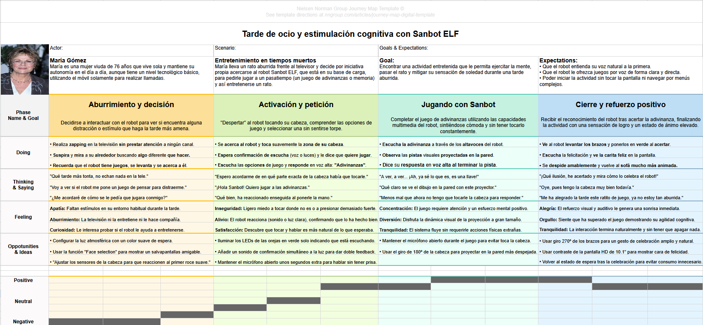

*Figure: User Journey Map "An afternoon of leisure and cognitive stimulation with Sanbot ELF", following the actor María Gómez through four phases (boredom and decision, activation and request, playing with Sanbot, closure and positive reinforcement), with rows for Doing, Thinking & Saying, Feeling and Opportunities & Ideas, and an emotion curve along the bottom (built on the Nielsen Norman Group journey map template).*

> **Text in the image (English translation):**
>
> *Header (faint):* Nielsen Norman Group Journey Map Template © — See template directions at nngroup.com/articles/journey-map-digital-template
>
> **Title:** An afternoon of leisure and cognitive stimulation with Sanbot ELF
>
> | Actor | Scenario | Goal | Expectations |
> | --- | --- | --- | --- |
> | **María Gómez** María is a 76-year-old widow who lives alone and maintains her independence in day-to-day life, although she has a basic level of technological skill, using her mobile phone only to make calls. | **Entertainment during idle time** María has been bored in front of the television for a while and decides, on her own initiative, to go up to the Sanbot ELF robot, which is on its charging base, to ask it to play a pastime (a riddle or memory game) and so entertain herself for a while. | Find an entertaining activity that lets her exercise her mind, pass the time and ease her feeling of loneliness during a boring afternoon. | • That the robot understands her natural voice first time. • That the robot offers her games by voice, clearly and directly. • To be able to start the activity without touching the screen or navigating complex menus. |
>
> | Phase name & goal | Boredom and decision | Activation and request | Playing with Sanbot | Closure and positive reinforcement |
> | --- | --- | --- | --- | --- |
> | **Phase goal** | Decide to interact with the robot to see whether she finds some distraction or stimulus that makes the afternoon more pleasant. | "Wake up" the robot by touching its head, understand the game options and select one without feeling clumsy. | Complete the riddle game using the robot's multimedia capabilities, feeling comfortable and without having to touch it constantly. | Receive recognition from the robot after guessing the riddle correctly, ending the activity with a sense of achievement and a lifted mood. |
> | **Doing** | • Channel-hops (zapping) on the television **without paying attention** to any channel. • **Sighs** and looks **around her**, searching for **something** different **to do**. • **Remembers** that the **robot has games**, **gets up** and **goes over to it**. | • **Goes up to the robot** and **gently touches** its **head area**. • **Waits for confirmation that it is listening** (voice or lights) and **tells** it that she **wants to play**. • **Listens** to the **game options** and **answers** out loud: **"Riddles"**. | • **Listens to the riddle** through the robot's **speakers**. • **Watches** the visual **clues projected on the wall**. • **Says** her **answer out loud when** the clue **finishes**. | • **Sees** the robot **raise its arms** and turn them **green** when she **gets it right**. • **Hears** the congratulations and **sees the little happy face** on the screen. • **Says goodbye kindly** and goes back to the **sofa in much better spirits**. |
> | **Thinking & Saying** | "What a dull afternoon, there's nothing on the telly." "I'll see if the robot will put on a thinking game for me to take my mind off things." "Will I remember how to ask it to play with me?" | "I hope I remember exactly which part of its head I had to touch." "Hello Sanbot! I want to play riddles." "Good, it reacted straight away when I put my hand on it." | "Let me see, let me see… Ah, I know what it is, it's a key!" "How clearly you can see the drawing on the wall with this projector." "Thank goodness I don't have to touch its head now to answer." | "How exciting, I got it right and look how the robot is celebrating!" "Well, my head is still in very good shape." "This little bit of play has brightened up my afternoon, I'm not so bored any more." |
> | **Feeling** | **Apathy:** there is a lack of stimuli in her usual surroundings during the afternoon. **Boredom:** the television neither entertains her nor keeps her company. **Curiosity:** she is interested in trying whether the robot helps her pass the time. | **Insecurity:** slight fear of touching the wrong place or pressing too hard. **Relief:** the robot reacts (sound or clear light), confirming that she has done it right. **Satisfaction:** she discovers that touching and speaking is more natural than she expected. | **Concentration:** the game requires attention and a positive mental effort. **Enjoyment:** she enjoys the visual dynamics of the large-scale projection. **Calm:** the system flows without requiring strange physical actions from her. | **Joy:** the visual and auditory reinforcement brings an immediate smile. **Pride:** she feels she has beaten the game, demonstrating her cognitive agility. **Calm:** the interaction ends naturally, without her having to switch anything off. |
> | **Opportunities & Ideas** | • Set the ambient light to a soft standby colour. • Use the "Face selection" function to show a friendly screensaver. • "Adjust the head sensors so that they react to the first gentle touch." | • Light the ear LEDs green only to indicate that it is listening. • Add a confirmation sound at the same time as the light to give double feedback. • Keep the microphone open for a few extra seconds so she can speak without rushing. | • Keep the microphone open during the game to avoid touching the head. • Use the 180° head rotation to project onto the clearest wall. | • Use the 270° arm rotation for a broad, natural celebration gesture. • Use the contrast of the 10.1" HD screen to show a happy face. • Return to the standby state after the celebration to avoid unnecessary power consumption. |
>
> **Emotion curve** (scale labelled Positive / Neutral / Negative; three steps per phase, read on a 7-level scale where 1 = Negative, 4 = Neutral, 7 = Positive):
> - Boredom and decision: 1 → 1 → 2 (negative, starting to rise)
> - Activation and request: 3 → 4 → 6 (rising through neutral)
> - Playing with Sanbot: 6 → 7 → 7 (positive, reaching the peak)
> - Closure and positive reinforcement: 7 → 6 → 6 (remaining positive)

<!-- PDF page 15 -->

## 3. SYSTEM REQUIREMENTS

Functional requirements describe what the system must do, whereas non-functional requirements specify how it must do it, according to criteria such as usability, performance, accessibility or reliability, among others.

### 3.1. Functional requirements

Functional requirements describe what the system must do, whereas non-functional requirements specify how it must do it, according to criteria such as usability, performance, accessibility or reliability, among others.

**REQUIREMENTS TABLE**

| No. | Description | Prioritisation |
| --- | --- | --- |
| **RF1** | The user shall be able to play games. | |
| **RF1.1** | The user shall be able to listen to a brief explanation of the game before playing. | M |
| **RF1.2** | The user shall be able to see responses to their interactions in the games. | M |
| **RF1.3** | The user shall be able to view the games through the projector. | C |
| **RF2** | The user shall be able to manage activities. | |
| **RF2.1** | The user shall be able to schedule activities. | M |
| **RF2.1.1** | The user shall be able to dictate the fields of an activity to the robot using voice commands. | M |
| **RF2.2** | The user shall be able to receive alerts for scheduled activities by means of an alarm sound and the display of the information on screen. | M |
| **RF2.3** | The user shall be able to postpone an activity. | M |
| **RF2.4** | The user shall be able to mark an activity as completed. | M |
| **RF2.5** | The user shall be able to see the activities scheduled for today. | M |
| **RF2.6** | The user shall be able to see the list of all scheduled activities. | M |

<!-- PDF page 16 -->

| No. | Description | Prioritisation |
| --- | --- | --- |
| **RF2.7** | The user shall be able to edit an activity. | M |
| **RF2.8** | The user shall be able to delete an activity. | M |
| **RF2.9** | The user shall be able to classify activities as critical or non-critical, limiting the option to postpone to non-critical ones only. | C |
| **RF3** | The user shall be able to manage reminders. | |
| **RF3.1** | The user shall be able to schedule reminders. | M |
| **RF3.1.1** | The user shall be able to dictate the fields of a reminder to the robot using voice commands. | M |
| **RF3.2** | The user shall be able to receive alerts for scheduled reminders by means of an alarm sound and the display of the information on screen. | M |
| **RF3.3** | The user shall be able to see the list of all scheduled reminders. | M |
| **RF3.4** | The user shall be able to edit a reminder. | M |
| **RF3.5** | The user shall be able to delete a reminder. | M |
| **RF4** | The user shall be able to manage settings. | |
| **RF4.1** | The user shall be able to change the robot's volume. | M |
| **RF4.2** | The user shall be able to change the brightness of the robot's screen. | S |
| **RF5** | The user shall be able to manage their profile. | |
| **RF5.1** | The user shall be able to register. | M |
| **RF5.2** | The user shall be able to modify their profile. | M |
| **RF5.3** | The user shall be able to delete their profile. | M |

<!-- PDF page 17 -->

### 3.2. Non-functional requirements

**REQUIREMENTS TABLE**

| No. | Description |
| --- | --- |
| **RNF1** | The system shall be displayed and shall communicate entirely in Spanish. |
| **RNF1.1** | The system shall use clear, simple language adapted to older adults, avoiding unnecessary technical jargon. |
| **RNF2** | The system shall provide visual feedback in the games. |
| **RNF2.1** | The robot shall show a red colour on its body and/or a sad emotion when the user makes a mistake. |
| **RNF2.2** | The robot shall show a green colour on its body and/or a happy emotion when the user answers correctly. |
| **RNF3** | The system shall maintain a clear, understandable presentation adapted to the user's profile. |
| **RNF3.1** | Visual elements shall be simple, with high contrast and without information overload. |
| **RNF3.2** | The font size shall be large enough to make reading easier for older adults. |
| **RNF4** | The system shall visually prevent the option to postpone when an activity has already been postponed once. |
| **RNF5** | The system shall keep the alert for an active activity on screen until the user explicitly attends to it; it will not disappear automatically. |
| **RNF6** | The system shall reflect the change of status of a completed activity immediately and visibly in the list. |
| **RNF7** | The system shall visually highlight upcoming activities in the day's list when there are less than 5 minutes until they start, rather than treating them the same as the rest. |
| **RNF8** | The system shall delete reminders once the user has confirmed their alert. |
| **RNF9** | The system shall prevent an activity or reminder from being saved if the mandatory fields have not been filled in. |
| **RNF10** | The system shall prevent an activity or reminder from being scheduled for a date and time earlier than the present moment. |

<!-- PDF page 18 -->

| No. | Description |
| --- | --- |
| **RNF11** | The system shall offer a date and time picker, not a free-text field, to avoid format errors. |

<!-- PDF page 19 -->

## 4. ARCHITECTURE AND INTERACTION DESIGN

### 4.1. Navigation structure

The **navigation structure of the application** has been designed so that the user can move from one screen to another without long paths or changes of context that are difficult to interpret. The following figure shows the **general screen flow**.

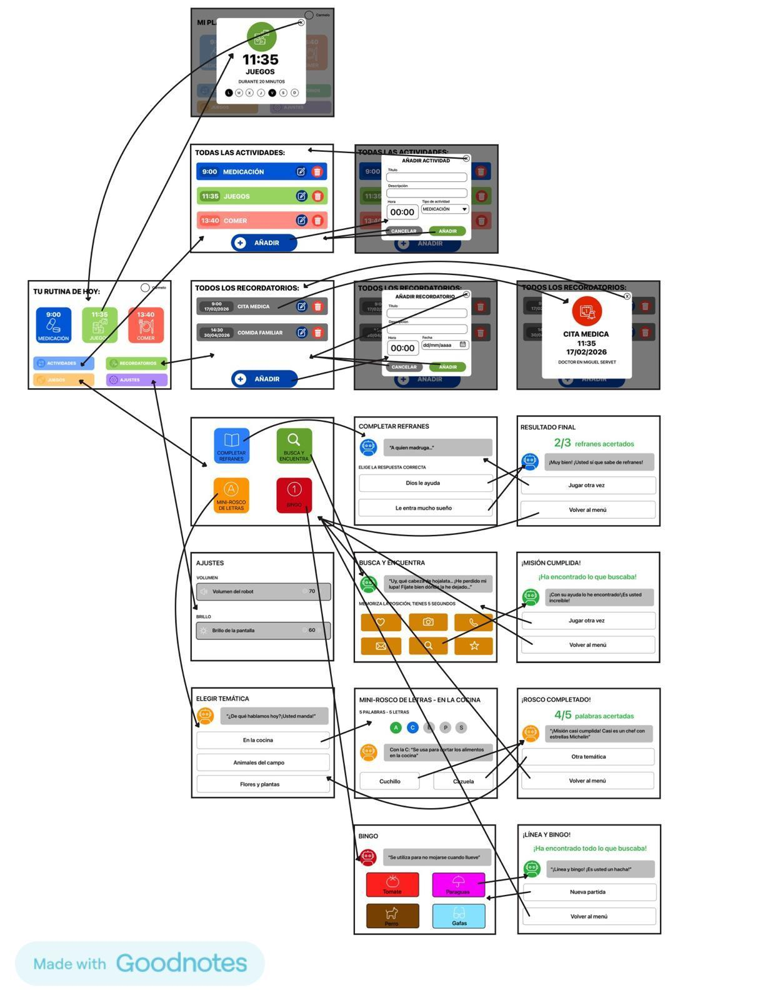

*Figure: General screen flow of the application, drawn by hand over the prototype screens (made with Goodnotes). Arrows link the home screen "Your routine for today" to the activity detail pop-up, the activities and reminders lists with their "Add" forms, the reminder alert, the games menu and each game with its final result screen, the theme selection for the Mini-Rosco, and the settings screen.*

> **Text in the image (English translation):**
> - **Home – YOUR ROUTINE FOR TODAY:** user name "Carmelo"; tiles 9:00 MEDICATION, 11:35 GAMES, 13:40 EATING; buttons ACTIVITIES, REMINDERS, GAMES, SETTINGS.
> - **Activity detail pop-up** (over "MY PL[AN]…"): 11:35 – GAMES – FOR 20 MINUTES; weekday circles L M X J V S D (Monday to Sunday); close button (X).
> - **ALL ACTIVITIES:** 9:00 MEDICATION, 11:35 GAMES, 13:40 EATING (each with edit and delete icons); button ADD.
> - **ADD ACTIVITY form:** Title, Description, Time (00:00), Activity type (MEDICATION ▾); buttons CANCEL, ADD.
> - **ALL REMINDERS:** 9:00 17/02/2026 – MEDICAL APPOINTMENT; 14:30 30/04/2026 – FAMILY LUNCH; button ADD.
> - **ADD REMINDER form:** Title, Description, Time (00:00), Date (dd/mm/yyyy); buttons CANCEL, ADD.
> - **Reminder alert:** MEDICAL APPOINTMENT – 11:35 – 17/02/2026 – DOCTOR AT MIGUEL SERVET.
> - **Games menu:** COMPLETE SAYINGS, SEEK AND FIND, MINI-ROSCO OF LETTERS, BINGO.
> - **COMPLETE SAYINGS:** robot: "The early riser…" (*A quien madruga…*); CHOOSE THE CORRECT ANSWER: "God helps them" / "They get very sleepy". → **FINAL RESULT:** 2/3 sayings correct; robot: "Very good! You really do know your sayings!"; Play again / Back to menu.
> - **SEEK AND FIND:** robot: "Oops, what a tin head I've got… I've lost my magnifying glass! Look carefully at where I've left it…"; MEMORISE THE POSITION, YOU HAVE 5 SECONDS; six cards (heart, camera, phone, envelope, magnifying glass, star). → **MISSION ACCOMPLISHED!** You found what you were looking for!; robot: "With your help I found it! You're incredible!"; Play again / Back to menu.
> - **SETTINGS:** VOLUME – Robot volume 70; BRIGHTNESS – Screen brightness 60.
> - **CHOOSE THEME:** robot: "What shall we talk about today? You're the boss!"; In the kitchen / Farm animals / Flowers and plants.
> - **MINI-ROSCO OF LETTERS – IN THE KITCHEN:** 5 WORDS – 5 LETTERS; letters A C E P S; robot: With C: "It is used to cut food in the kitchen"; options *Cuchillo* (knife) / *Cazuela* (casserole dish). → **ROSCO COMPLETED!** 4/5 words correct; robot: "Mission almost accomplished! You're almost a Michelin-starred chef"; Another theme / Back to menu.
> - **BINGO:** robot: "It is used to keep from getting wet when it rains"; cards Tomato, Umbrella, Dog, Glasses. → **LINE AND BINGO!** You found everything you were looking for!; robot: "Line and bingo! You're a real ace!"; New game / Back to menu.

<!-- PDF page 20 -->

### 4.2. Wireframes and prototypes

This subsection contains the **wireframes of the application**, used to represent schematically the structure of the screens and the layout of their main elements.

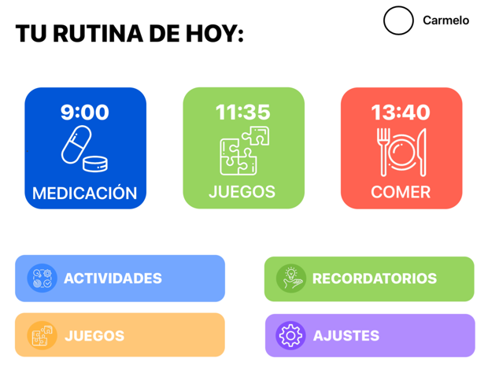

*Figure: Home screen showing the day's routine as three large coloured tiles and four access buttons to the main sections.*

> **Text in the image (English translation):**
> - YOUR ROUTINE FOR TODAY: — user "Carmelo"
> - Tiles: 9:00 MEDICATION · 11:35 GAMES · 13:40 EATING
> - Buttons: ACTIVITIES · REMINDERS · GAMES · SETTINGS

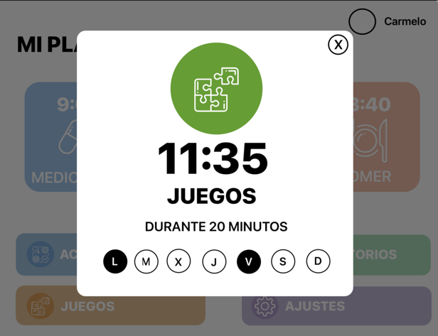

*Figure: Pop-up with the details of a scheduled activity shown over the home screen.*

> **Text in the image (English translation):**
> - Background: "MY PL[AN]…" (partly hidden), user "Carmelo"
> - 11:35 · GAMES · FOR 20 MINUTES
> - Weekdays: L M X J V S D (Monday to Sunday; Monday and Friday selected)
> - Close button: X

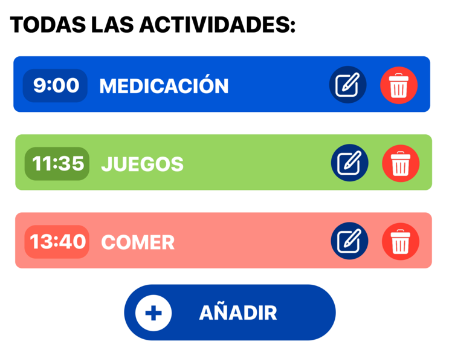

*Figure: List of all activities, each with edit and delete buttons, and an add button.*

> **Text in the image (English translation):**
> - ALL ACTIVITIES:
> - 9:00 MEDICATION · 11:35 GAMES · 13:40 EATING
> - ADD

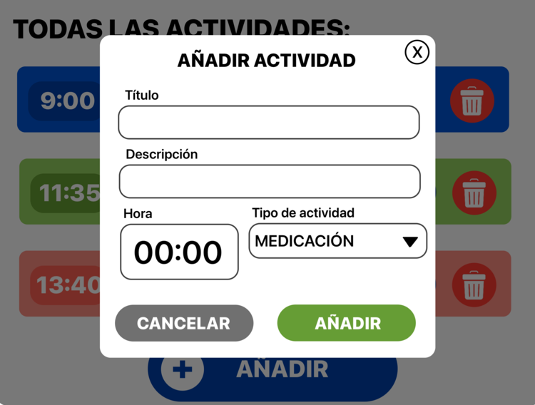

*Figure: Form for adding a new activity, shown as a pop-up over the activities list.*

> **Text in the image (English translation):**
> - ADD ACTIVITY
> - Fields: Title · Description · Time (00:00) · Activity type (MEDICATION ▾)
> - Buttons: CANCEL · ADD

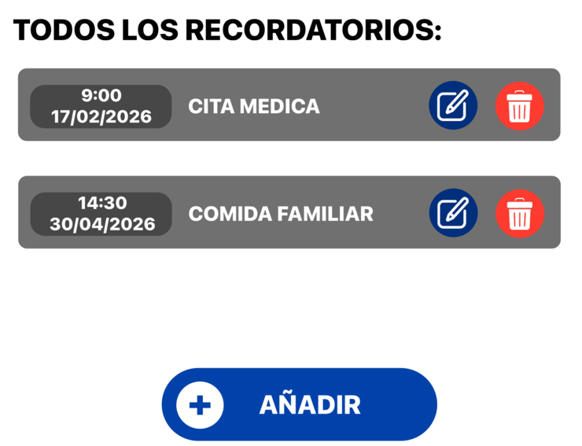

*Figure: List of all reminders with date and time, each with edit and delete buttons, and an add button.*

> **Text in the image (English translation):**
> - ALL REMINDERS:
> - 9:00 17/02/2026 – MEDICAL APPOINTMENT
> - 14:30 30/04/2026 – FAMILY LUNCH
> - ADD

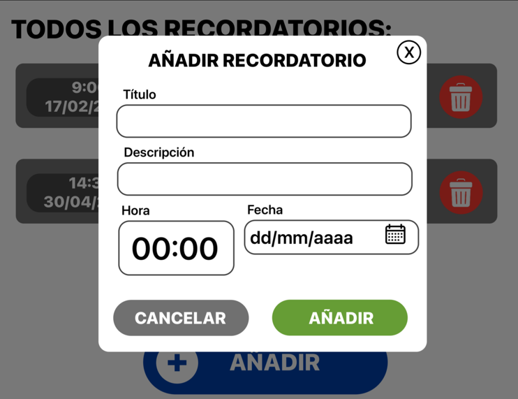

*Figure: Form for adding a new reminder, shown as a pop-up over the reminders list.*

> **Text in the image (English translation):**
> - ADD REMINDER
> - Fields: Title · Description · Time (00:00) · Date (dd/mm/yyyy)
> - Buttons: CANCEL · ADD

<!-- PDF page 21 -->

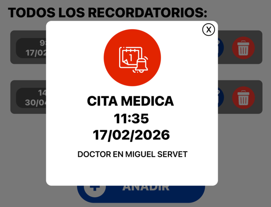

*Figure: Reminder alert displayed over the reminders list.*

> **Text in the image (English translation):**
> - Background: ALL REMINDERS:
> - MEDICAL APPOINTMENT · 11:35 · 17/02/2026
> - DOCTOR AT MIGUEL SERVET
> - Close button: X

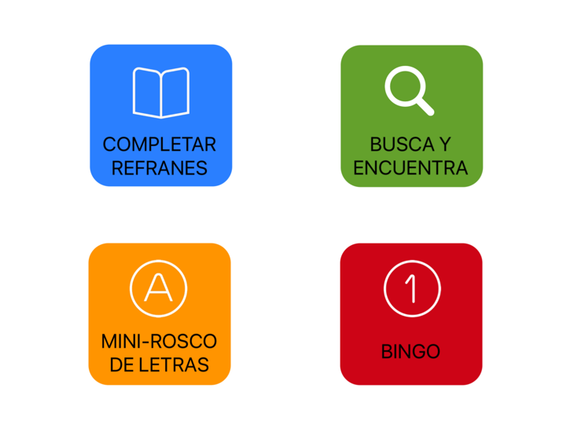

*Figure: Games menu with four large coloured buttons, one per game.*

> **Text in the image (English translation):**
> - COMPLETE SAYINGS · SEEK AND FIND · MINI-ROSCO OF LETTERS · BINGO

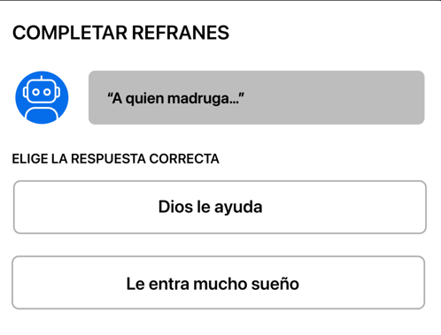

*Figure: Sayings game screen, in which the robot starts a saying and the user chooses how it ends.*

> **Text in the image (English translation):**
> - COMPLETE SAYINGS
> - Robot: "The early riser…" (*"A quien madruga…"*, the start of the Spanish saying "God helps those who rise early")
> - CHOOSE THE CORRECT ANSWER
> - Options: "God helps them" (*Dios le ayuda*) · "They get very sleepy" (*Le entra mucho sueño*)

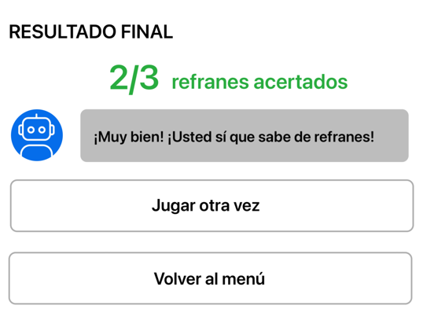

*Figure: Final result screen of the Sayings game.*

> **Text in the image (English translation):**
> - FINAL RESULT
> - 2/3 sayings correct
> - Robot: "Very good! You really do know your sayings!"
> - Buttons: Play again · Back to menu

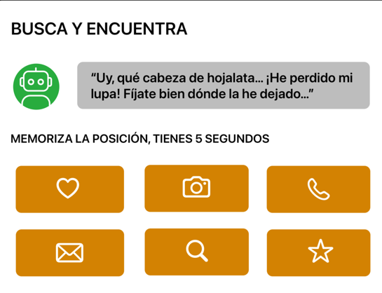

*Figure: Seek and Find game screen with six cards whose positions the user must memorise.*

> **Text in the image (English translation):**
> - SEEK AND FIND
> - Robot: "Oops, what a tin head I've got… I've lost my magnifying glass! Look carefully at where I've left it…"
> - MEMORISE THE POSITION, YOU HAVE 5 SECONDS
> - Cards (icons only): heart, camera, phone, envelope, magnifying glass, star

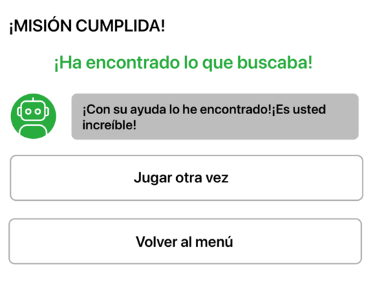

*Figure: Completion screen of the Seek and Find game.*

> **Text in the image (English translation):**
> - MISSION ACCOMPLISHED!
> - You found what you were looking for!
> - Robot: "With your help I found it! You're incredible!"
> - Buttons: Play again · Back to menu

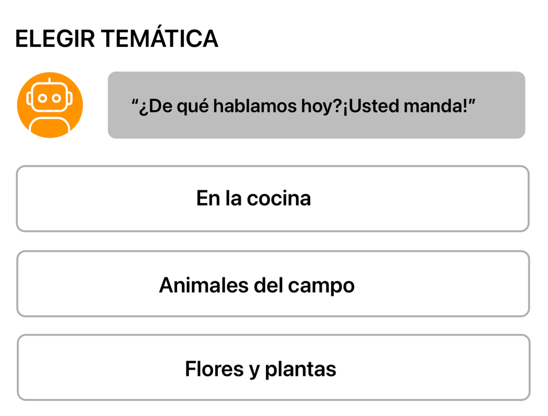

*Figure: Theme selection screen for the Mini-Rosco game.*

> **Text in the image (English translation):**
> - CHOOSE THEME
> - Robot: "What shall we talk about today? You're the boss!"
> - Options: In the kitchen · Farm animals · Flowers and plants

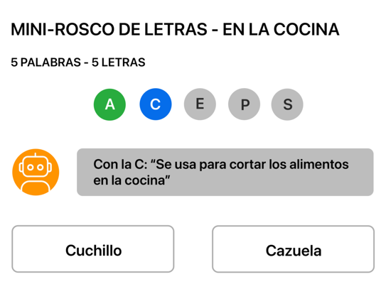

*Figure: Mini-Rosco game screen for the "In the kitchen" theme, with the letter wheel and two answer options.*

> **Text in the image (English translation):**
> - MINI-ROSCO OF LETTERS – IN THE KITCHEN
> - 5 WORDS – 5 LETTERS
> - Letters: A (green, done) · C (blue, current) · E · P · S
> - Robot: With C: "It is used to cut food in the kitchen"
> - Options: *Cuchillo* (knife) · *Cazuela* (casserole dish)

<!-- PDF page 22 -->

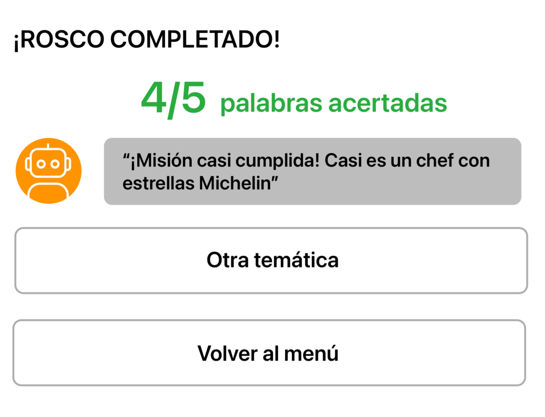

*Figure: Completion screen of the Mini-Rosco game.*

> **Text in the image (English translation):**
> - ROSCO COMPLETED!
> - 4/5 words correct
> - Robot: "Mission almost accomplished! You're almost a Michelin-starred chef"
> - Buttons: Another theme · Back to menu

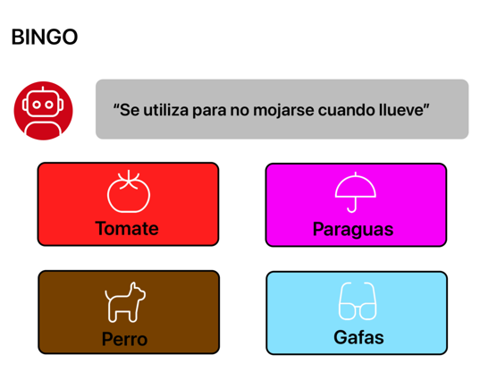

*Figure: Bingo game screen, in which the robot gives a clue and the user taps the matching card.*

> **Text in the image (English translation):**
> - BINGO
> - Robot: "It is used to keep from getting wet when it rains"
> - Cards: Tomato · Umbrella · Dog · Glasses

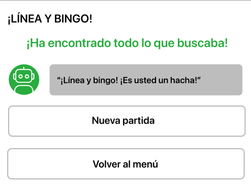

*Figure: Completion screen of the Bingo game.*

> **Text in the image (English translation):**
> - LINE AND BINGO!
> - You found everything you were looking for!
> - Robot: "Line and bingo! You're a real ace!"
> - Buttons: New game · Back to menu

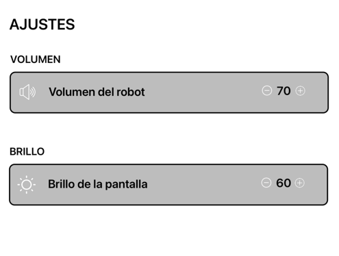

*Figure: Settings screen with volume and brightness controls.*

> **Text in the image (English translation):**
> - SETTINGS
> - VOLUME: Robot volume − 70 +
> - BRIGHTNESS: Screen brightness − 60 +

### 4.3. User interface

Since the application is intended to be used from the **robot's built-in screen**, priority has been given to ensuring that the main elements can be identified quickly and that touch interaction relies on large, well-separated areas. For this reason, the **layout of each screen** avoids concentrating too much information at once and organises the elements into distinct blocks, so that the main action remains visible without having to scan the whole interface visually. This decision is relevant on a device with a 10.1-inch built-in touchscreen, where the size of the elements and the spacing between them directly determine ease of use.

As for the **colour palette**, we opted to use **light backgrounds and distinct tones** to identify the different functional blocks of the application. In this way, activities, reminders, games and settings can be recognised visually more quickly. The **use of colour** was not conceived merely as an aesthetic resource, but as **an aid to distinguishing sections**, highlighting interactive elements and marking certain states of the interface, such as final screens or result messages. This strategy helps make the application easier to scan visually and helps the user find their way between sections.

**Typography and text size** have also been treated as central decisions of the visual design. Instead of using a uniform scale on all screens, visible differences have been established between titles, subtitles, robot messages, buttons and secondary text. This **hierarchy** allows the **main information** to stand out

<!-- PDF page 23 -->

immediately and the remaining elements to play a supporting role without competing visually with the main action of each screen. Likewise, the **increased text size** on buttons, banners and messages aims to make direct reading from the robot's screen easier and to reduce the effort needed to interpret each view.

Regarding the **icon style**, a recognisable line has been followed, linking each icon to **everyday actions or concepts** such as calendar, settings, game or reminder. This decision helps reinforce the meaning of each button or card without relying exclusively on text. In addition, large shapes, rounded buttons and well-defined containers have been used, so that each **interactive element** can be located visually and pressed comfortably. The choice of this style does not respond only to a graphic preference, but to the need for the interface to maintain **consistency between screens** and to make touch interaction less prone to errors.

Overall, the **visual style of the application** has been defined to combine clarity and consistency. **Clarity** is sought through typographic styles, spacing between blocks and large buttons; **consistency**, through recurring resources such as banners, the robot's speech bubbles and stable colours for each section. In this way, the interface does not merely display information, but actively contributes to making the user experience more understandable and better suited to the device and the user for whom it has been developed.

### 4.4. Controls and interactions

The **main interaction** of the application is based on the use of **direct touch controls** on the robot's screen. This decision was taken bearing in mind the profile of the user the proposal is aimed at, since the aim is to avoid interactions that depend on complex gestures or poorly visible menus. For this reason, the application **relies mainly on** large buttons, tappable cards, simple selectors and forms reduced to strictly necessary actions. In this way, the user can easily identify which elements are interactive and what action each of them performs.

**Buttons** are the most widely used control throughout the application. They are used both on the main screen, to access the activities, reminders, games and settings sections, and on the internal screens of each functional block. **In the games**, for example, buttons allow the user to choose answers, select cards or move forward within a particular activity. **On the final screens**, they are used to repeat the activity or return to the menu. **In activities and reminders**, buttons are used to add new items, edit existing ones or delete them. Their function has been kept stable throughout the application so that the user does not have to reinterpret the meaning of the control each time they change screen.

**Navigation between screens** has been resolved through a simple structure based on direct shortcuts and a **top banner** on the secondary screens. This element allows the user to go back in a visible and constant way, so that they keep a clear reference for how to leave a screen or return to the previous level. The choice of this system responds to the need for navigation not to depend on hidden gestures.

As for **forms**, the application only uses them in specific contexts, such as the **creation or editing** of activities and reminders. In these cases, we opted for a

<!-- PDF page 24 -->

simple structure based on a limited number of fields and clearly differentiated actions, so that the user can **enter or modify information** without facing a cluttered interface. The aim has not been to bring a large number of options to the screen, but to allow each editing task to be completed with a small number of decisions.

Regarding **touch gestures**, the proposal is not based on advanced interactions such as complex swipes, combinations of gestures or hidden actions. Most use is handled through **direct taps on visible elements**. This choice is consistent with the intended type of user, as it reduces the need for prior learning and makes interaction depend on easily recognisable actions. Consequently, the application uses deliberately simple touch interaction, centred on tapping, selecting, going back and adjusting basic parameters when necessary.

The **results of each action** are communicated to the user through several complementary resources. Firstly, **screen changes** are used to indicate the move from one phase to another, for example when finishing a game or returning to the menu. Secondly, **robot messages and visible text** on screen are used to introduce the action, confirm what has happened or reinforce the end of an activity. Thirdly, **final screens with result messages** are used to signal that an interaction has concluded. This system ensures that actions do not go without a perceptible response and that the user can clearly understand when they have completed a task, what has happened after pressing a button or what option is available next.

In relation to the **intended user**, the interaction used in the application responds to a criterion of **low operational complexity**. This means that priority has been given to a way of using the app based on few controls, visible actions and short paths. The aim has not been for the user to explore many possibilities, but for them to be able to complete specific tasks confidently and without needing to remember long procedures. In this sense, the chosen interaction is **aligned with the overall objective** of the project: to turn the robot into an everyday support that presents actions in an accessible way and accompanies the user while they carry them out.

<!-- PDF page 25 -->

## 5. MARKETING AND ADVERTISING

This section contains the materials produced to present the application from a visual and communicative perspective. Through the icon, the promotional screenshots, the video and the demo, the most representative functions of the system are shown in summary form, together with the way in which the proposal can be transferred to a public presentation format.

### 5.1. Promotional screenshots / icon

For the visual presentation of the application, **an icon and a promotional screenshot** have been designed that summarise the project's value proposition. Both resources aim to communicate quickly and attractively the **main purpose** of the app: helping older adults to organise their daily routine, receive reminders and stay active through simple activities and short games.

The **application icon** uses a visual composition centred on the relationship between the Sanbot ELF robot and the older adult user. It features **elements associated** with well-being and daily activity, such as the heart, the light bulb, the apple, the water and the brain. These **visual resources** reinforce the ideas of health, companionship, memory, everyday habits and cognitive stimulation. In addition, the **use of bright colours** aims to convey a friendly, positive and warm image, avoiding a technical or cold appearance.

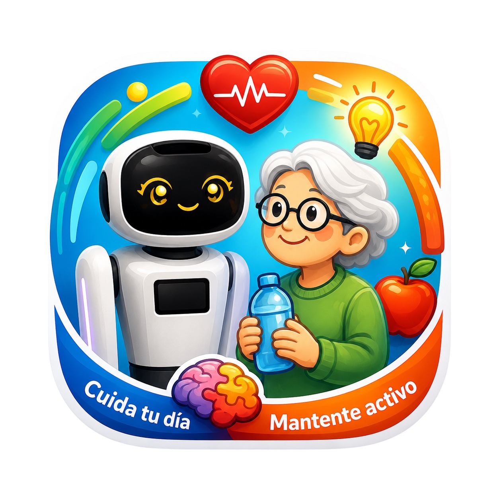

*Figure 1. Promotional icon of the application, centred on the relationship between the Sanbot ELF robot, the older adult and daily well-being habits.*

> **Text in the image (English translation):**
> - "Look after your day" (*Cuida tu día*)
> - "Stay active" (*Mantente activo*)

The **promotional screenshot** expands on this idea by presenting the product in a more explanatory way. In it, the robot is presented as a "smart companion for every day" and the **main benefits** of the application are highlighted: organising the day, remembering important activities, suggesting games that exercise the mind and offering a simple and friendly experience. To do this, **illustrated elements of the robot and the user** are combined with screenshots of the application's interface, showing screens such as activities, add activity, reminders, games and settings.

<!-- PDF page 26 -->

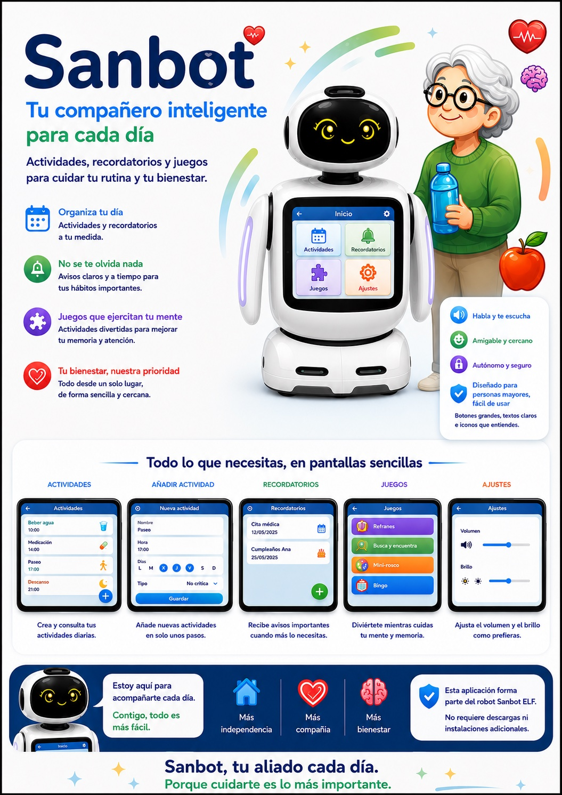

*Figure 2. Promotional screenshot of the application, summarising the main functions and showing real screens from the prototype.*

> **Text in the image (English translation):**
> - **Sanbot** — Your smart companion for every day
> - Activities, reminders and games to look after your routine and your well-being.
> - **Organise your day:** Activities and reminders tailored to you.
> - **Nothing slips your mind:** Clear, timely alerts for your important habits.
> - **Games that exercise your mind:** Fun activities to improve your memory and attention.
> - **Your well-being, our priority:** Everything from a single place, in a simple and friendly way.
> - Robot screen: Home — Activities · Reminders · Games · Settings
> - Side panel: Talks and listens to you · Friendly and approachable · Autonomous and safe · Designed for older adults, easy to use — Large buttons, clear text and icons you understand.
> - **Everything you need, on simple screens**
>   - ACTIVITIES (screen "Activities": Drink water 10:00, Medication 14:00, Walk 17:00, Rest 21:00) — Create and check your daily activities.
>   - ADD ACTIVITY (screen "New activity": Name: Walk; Time: 17:00; Days: L M X J V S D; Type: Non-critical; Save) — Add new activities in just a few steps.
>   - REMINDERS (screen "Reminders": Medical appointment 12/05/2025; Ana's birthday 25/05/2025) — Receive important alerts when you need them most.
>   - GAMES (screen "Games": Sayings, Seek and find, Mini-Rosco, Bingo) — Have fun while looking after your mind and memory.
>   - SETTINGS (screen "Settings": Volume, Brightness) — Adjust the volume and brightness as you like.
> - Robot speech bubble: "I'm here to keep you company every day. With me, everything is easier."
> - More independence · More companionship · More well-being
> - This application is part of the Sanbot ELF robot. No downloads or additional installations required.
> - **Sanbot, your ally every day.** Because looking after yourself is what matters most.

The **design of the promotional screenshot** keeps the same visual line as the application: light backgrounds, colours differentiated by section, recognisable icons, short text and large buttons. Overall, the icon and the promotional screenshot reinforce the **product's identity** and help to summarise its main functions in a visual format that is easy to understand.

<!-- PDF page 27 -->

### 5.2. Promotional video

Due to the limitations of the **recording context**, the promotional video was made in the **laboratory** using the Sanbot ELF robot and the functional prototype of the application. The recording is not intended to represent a real test in an older adult's home, but a **usage simulation** that makes it possible to show the main journey through the app. To this end, **real shots** of the robot's screen and of the interaction with the interface have been used, showing the checking of the daily routine, the receipt of reminders, access to short games and the final reinforcement screens. The video's **narrative** is conceived as a guided demonstration of how the system works.

The **objective** of the video is to present briefly and understandably how the application can support the user's daily routine. To this end, the content has been structured as a **usage sequence**: first, access to the day's routine is shown, then the appearance of a reminder, next the touch interaction with the screen and, finally, access to a short game with its corresponding closing screen. In this way, the video is not limited to showing isolated screens, but builds a short journey that **reflects the main logic** of the application.

| No. | Clip | Voice-over |
| --- | --- | --- |
| 1 | Shot of the robot in the laboratory, with the app open. | "Sanbot ELF is a daily support for organising the routine of older adults." |
| 2 | Close-up of the main screen: "Your routine for today". A hand points to or taps a card. | "From the main screen, the user can see the activities planned for the day." |
| 3 | Alert or reminder screen: medication, medical appointment or hydration. | "When the time comes, the robot shows the alert and accompanies it with voice." |
| 4 | A member of the group taps confirm, accept or back. Only the hand needs to be shown. | "The interaction is based on simple steps and large buttons." |
| 5 | Games menu: sayings, seek and find, mini-rosco, bingo. | "The app includes short games to stimulate memory and attention." |
| 6 | Recording of a game in use. For example, seek and find or mini-rosco. | "Each game guides the user with visible instructions and messages from the robot." |
| 7 | Final result screen: "Very good!", "Mission accomplished" or "Back to menu". | "When finished, the system offers a closure and allows the user to continue or return to the start." |
| 8 | Final shot of the robot with the main screen or the app icon. | "Sanbot ELF: routine and companionship in a single experience." |

The **link to the promotional video** is provided below. It has been uploaded to Google Drive and configured so that anyone who has the link can view it:

<!-- PDF page 28 -->

[LINK TO THE PROMOTIONAL VIDEO](https://drive.google.com/file/d/1Ao9Sh6sxvjvYKOQ17Bvx81jxu6fQpPSP/view?usp=sharing)

### 5.3. Demo

In addition to the promotional video, a demo has been produced in **video format** to show the **operation of the functional prototype integrated** into the Sanbot ELF robot. Unlike the promotional video, whose aim is to present the application's value proposition in a brief and appealing way, this demo focuses on **showing** more clearly **how the system is used** and **how to navigate** its main screens.

The **recording** was made in the laboratory, using the Sanbot ELF robot and the application developed. It shows a **functional walkthrough** of the main sections of the app: home screen, activities, reminders, games and settings. It also includes **examples of touch interaction and voice support**, in order to show how the user can check their routine, create or modify items, access short activities and receive feedback from the system.

This demo makes it possible to **complement the written explanation in the report**, as it shows the real behaviour of the prototype on the device for which it was designed. Although the recording **does not reproduce a real home setting**, it does make it possible to check the navigation, the clarity of the screens, the use of large buttons and the integration of the robot's voice as a resource to support interaction.

Below is the **link to the demo**, uploaded to Google Drive and configured so that it can be viewed by anyone who has the link:

[LINK TO THE DEMO](https://drive.google.com/file/d/1DtX0T4-RqSQdsBue_yNJjf-zka5gaaD4/view?usp=sharing)

<!-- PDF page 29 -->

## 6. LIMITATIONS AND CONSTRAINTS

The development of this application is **conditioned** by a **series of limitations and constraints** that have influenced design and implementation decisions. These constraints should not be understood only as obstacles, but as **factors that delimit the real scope** of the project and help to justify why some functions have been prioritised over others.

**Technical limitations.** The first relevant constraint is the **hardware and software environment** of the Sanbot ELF robot itself. The application has been designed to run on a specific device, with an integrated 10.1-inch touch screen, voice control, brightness and volume settings and a particular set of functions available in the robot's system. This makes it possible to develop a **realistic solution on the target platform**, but it also prevents any interaction from being designed without taking into account the actual capabilities of the device. For example, the interface must adapt to the screen size and to direct touch interaction, and the functions implemented must be compatible with the resources already present in the robot.

During implementation, some specific constraints related to **permissions and the simultaneous execution of the robot's functions** were also identified. In the case of the **brightness setting**, the functionality has been left simulated within the interface, since changing the actual screen brightness **requires system permissions** that cannot be added from the application in the robot's environment. Even so, the visual control has been kept within the settings section to **represent how this option would work** in a version with full access to those permissions.

Another technical limitation relates to the **combination of certain expressive responses** of the robot. Some actions could not be executed simultaneously in a direct way, such as **moving the robot's head and performing actions on the screen** at the same time. Although one possible solution would have been to manage these actions using **threads**, this option was ruled out due to the project's time limitations. For this reason, the decision was made to only **show a facial expression on screen and activate colours on the arms** together. Thus, for incorrect answers in the games, the combination of a sad face and a feedback colour was chosen, instead of also adding head movement.

In addition, the project has been developed within an **academic scope limited in time and resources**. For this reason, we chose to implement a functional base centred on activities, reminders, games and settings, leaving out other more ambitious ideas that came up in the early stages, such as the possibility of adding content for future extensions or much more advanced personalisation systems.

**Functional scope constraints.** The application does not aim to cover every possible need of an older adult who lives alone, nor to replace other personal, healthcare or family support systems. Its role is limited to **offering low-intensity everyday help** based on routine, reminders and short activities. Consequently, it has not been designed as a telecare system, a clinical tool or a channel for permanent remote monitoring. This constraint is important because it

<!-- PDF page 30 -->

**clearly defines what kind of help the robot can offer** and avoids attributing to it functions that go beyond the real objective of the project.

**Legal and liability limitations.** Although the application includes reminders and everyday support, it cannot be considered a medical device or a medical monitoring tool. Notifications related to medication, hydration or daily habits **must be understood as organisational support** and not as a guarantee of compliance or as professional validation of the user's condition. Likewise, any function linked to **physical or cognitive wellbeing** is designed at a non-clinical level and does not replace the intervention of healthcare professionals, caregivers or family members when this is necessary.

**Ethical and social constraints.** The project starts from a **clear premise**: the robot must complement the user's daily life, not replace human interaction. This ethical constraint is important in a system aimed at older adults who live alone, since a **technological solution** of this kind could be perceived as problematic if it were presented as a replacement for family or social ties. For this reason, the proposal has been oriented towards **reinforcing independence, routine and light companionship**, maintaining the idea that the robot is a support and not a substitute for personal relationships. This concern was already present in the secondary user profile and in the earlier formulation of the project.

There is also a social constraint related to **acceptance of the device**. Although the information gathering showed a favourable disposition towards spoken reminders, short games and a robot with a friendly appearance, not all users will have the same **degree of comfort with a robotic presence** in the home. This means that the proposal must avoid intrusive behaviour and maintain a balance between the system's initiative and respect for the user's pace. As well as showing the status of the microphone when it is activated to make recordings for any purpose, or avoiding switching on the microphone without the user's permission.

**Methodological and delivery constraints.** The project has been developed following an **iterative and incremental methodology**, precisely because the interaction design and the user experience could not be properly resolved in a single closed phase. This approach has made it possible to progress through versions and refine the proposal progressively, but it also means that the current version of the application should be understood as a **functional solution within the time frame** of the course, not as a product deployed in a real context of prolonged use. In other words, some decisions have been made prioritising feasibility, the coherence of the prototype and the possibility of evaluation within the academic calendar.

Overall, these **limitations and constraints** have served to narrow down the project, keep it aligned with the real device and avoid promises of functionality that could not be justified either technically or ethically. Thanks to this, the final proposal remains within a realistic framework that is consistent with the objective of the work.

<!-- PDF page 31 -->

## 7. UX AND ACCESSIBILITY

This section describes how usability and accessibility criteria have been taken into account during the design and implementation of the application, as well as how its evaluation with users has been approached.

### 7.1. Usability principles

To improve the **usability of the application**, **several of Nielsen's heuristics** have been taken as a reference, since they make it possible to analyse whether an interface makes it easy for the user to understand what they can do, what is happening at each moment and how to correct their actions if they make a mistake. In our case, these heuristics have been applied bearing in mind that the application is aimed at older adults who live alone and who interact with the system through the touch screen of the Sanbot ELF robot.

1. Firstly, the heuristic of **visibility of system status** has been considered. The application tries to show at all times which screen is active, what action is expected from the user and what has happened after each interaction. This is reflected, for example, in the robot's messages during the games, in the end screens that indicate whether an activity has finished and in the texts that report the result obtained. In this way, the user does not have to work out for themselves whether the system has responded or whether the action performed has taken effect.

2. The heuristic of **match between the system and the real world** has also been applied. To this end, the application uses words, icons and actions related to the user's everyday situations, such as the various activities. This decision reduces the need to interpret technical terms or unfamiliar conventions.

3. Another important heuristic has been **user control and freedom**. On the secondary screens, a top banner with a back arrow has been added, so that the user can go back in a visible and consistent way. In addition, at the end of the games, clear actions are offered to replay the game or return to the menu. This form of navigation means the user does not have to rely on remembering how to exit a screen.

4. The heuristic of **consistency and standards** has also guided the design. In different parts of the application, similar solutions are repeated for similar functions: top banners, large buttons, end screens with a comparable structure and main access points grouped into stable blocks. This repetition is intended to help the user recognise usage patterns and not have to relearn the logic of the interface when moving from one section to another.

5. Likewise, the heuristic of **error prevention** has been taken into account. The application avoids deep menus, hidden actions and screens with too many simultaneous options. Instead, it presents a small number of actions per view and uses large, well-separated touch controls. This decision reduces the likelihood of accidental taps and reduces the chance of the user hesitating between several similar options.

<!-- PDF page 32 -->

6. Finally, the heuristic of **recognition rather than recall** has been applied. The design tries to ensure that the user recognises what they can do on each screen through visible buttons, icons associated with specific functions and messages from the robot. Thus, the interaction does not depend so much on memorising paths or procedures, but on visually identifying the main action available at each moment.

Overall, the application has been designed **with the aim of making the interaction predictable, guided and stable**. Applying these heuristics has made it possible to guide specific decisions about navigation, the presentation of information and the design of controls, with the aim of making the user experience better suited to the profile of the intended user.

### 7.2. Accessibility

The **accessibility of the application** has been approached as a necessary criterion so that the **system can be used by the greatest possible number of people within the context** of the project. In this case, accessibility is not limited to a single aspect, but affects how texts are presented, how on-screen elements are tapped, how the navigation is understood and how information is reinforced.

1. With regard to **visual accessibility**, large text sizes have been used in titles, buttons and main messages, so that the most important information can be found and read more easily. In addition, efforts have been made to keep sufficient spacing between functional blocks and between touch elements, so that each interaction area is clearly distinguished from the rest. Distinct colours have also been used for the different sections of the application, which helps to identify each block visually without relying solely on text.

2. As regards **motor accessibility**, the application has been designed around simple taps on large buttons and wide touch areas. No complex gestures, barely visible double actions or sequences requiring great precision have been used. This decision is important in a context in which the user may have reduced manual dexterity or interact more slowly with the touch screen. Similarly, reducing the number of options per screen helps the main action to be carried out without unnecessary movements.

3. Regarding **cognitive accessibility**, we have tried to make the structure of the application easy to follow. To this end, we have worked with shallow navigation, screens with a clearly defined main function and a visual organisation based on clearly separated blocks. Short messages are also used to introduce activities, show results and guide the user during the interaction. This reduces memory load and prevents the user from having to continually work out what they need to do or where they are in the journey.

4. The application also incorporates an element of **auditory and multimodal support**, since the robot can accompany the visual information with spoken messages. This combination means that certain actions do not depend exclusively on reading the screen and that the user receives additional reinforcement when the system introduces an activity, triggers a reminder or communicates a result. In this sense, the robot's voice acts as a complement to the visual interface.

<!-- PDF page 33 -->

Even so, it is important to point out that the application **does not aim to fully resolve every possible accessibility need**. Rather, it incorporates a series of measures aimed at reducing barriers to use within the real scope of the project and of the available device.

### 7.3. UX evaluation

To evaluate the user experience (UX), a specific test was carried out on the **functional prototype integrated** into the Sanbot ELF robot. The evaluation was designed taking into account the current phase of the project, in which the application was no longer just a visual proposal or a set of wireframes, but an **interactive system** that could be tested from the robot's touch screen. For this reason, the main objective was not only to check whether the screens were understandable, but to **analyse** how users interpreted the complete interaction with the system.

To carry out the evaluation, a combination of **Extended usability testing** and **Semi-structured experience interview** was selected. The first method was used as the main method, since it makes it possible to **observe** the user while they interact with the system and carry out specific tasks. As a complement, a semi-structured interview was used at the end of the test, in order to gather the participants' **subjective perception** of the clarity, usefulness, comfort and sense of companionship generated by the application.

The test was carried out with **five participants**, combining young users with technological experience and older adults, closer to the project's target profile. Although the sample **does not fully represent the final audience** of older adults who live alone, it made it possible to detect relevant problems related to navigation, visual clarity, touch interaction and the use of the robot's voice. When interpreting the results, **this limitation was taken into account**, distinguishing between general usability problems and aspects that should be validated in the future with end users in a real home setting.

The **proposed tasks** were designed to **go through the main functions** of the application. The participants **completed** the initial registration, created a weekly activity, checked the day's routine, edited an existing activity, created a one-off reminder, accessed the games menu, completed a basic interaction within a game, reviewed an end screen and changed the volume from the settings section. The tasks **were set by stating only the goal** that the participant had to achieve, without explaining in advance which buttons to press or which path to follow. In this way, it was possible to observe whether the navigation structure, the texts, the icons, the touch controls and the voice instructions **were sufficiently clear** from first contact.

The **results** were **positive** overall. The participants understood the main structure of the application and correctly identified the activities, reminders, games and settings sections. The home screen was understood as the **access point** to the daily routine and to the most important functions of the system. The navigation was also rated favourably, especially because of the presence of **constant elements** for going back.

<!-- PDF page 34 -->

One of the **most highly rated aspects** was the role of the robot as a companionship element. The **physical presence** of the Sanbot ELF and the **use of voice** were perceived as differentiating elements compared with a conventional mobile or tablet app. Several participants pointed out that the robot felt **more approachable** because it has a face, a physical presence and the ability to speak, which can reinforce the feeling of companionship. The voice was also rated positively **in the case of notifications and reminders**, as it allows the user to receive information even when they are not looking directly at the screen.

However, the evaluation made it possible to detect **several important issues**. The main difficulty was related to **voice interaction** and to the **gesture of touching the robot's head**. Some participants did not understand when they had to touch the head to activate listening, when they could start speaking or whether the robot was listening at that moment. In some cases, users tried to speak before the robot had finished the instruction, which could cause overlap between the robot's voice and the user's response. This problem is relevant because voice is one of the **central resources of the experience** and must be clearly guided so as not to cause confusion.

**Problems** related to **visual clarity** and system **feedback** were also detected. Several participants indicated that the **size** of some texts should be increased. In the games, some **answer options** were not clearly perceived as interactive buttons, which led one participant to try to answer by using the robot's head instead of tapping an option on screen. In the settings, several users were unsure whether the volume change **was saved automatically**, since there was no confirmation button or message indicating that the setting had been applied correctly. In addition, in the activity and reminder forms it was observed that some fields did not stand out enough or did not make clear which ones were mandatory.

Based on these results, **several improvements for future versions** of the prototype were defined. The priority improvements are to **increase** the font size, **add** a visual indicator of active listening and **allow** instructions to be repeated on screens where voice is needed to complete the action. It is also proposed to **reduce** the length of some voice messages to prevent them from becoming tedious or the user trying to answer too early. In the settings section, the plan is to **incorporate** a "Save" or "Apply changes" button, accompanied by a confirmation message. For the games, it is proposed to **visually reinforce** the answer buttons through greater contrast, borders or shading. Finally, it is recommended to **review** the activity and reminder forms, simplifying labels, reordering fields and validating mandatory data before allowing the action to be confirmed.

Overall, the evaluation confirms that the application has **a clear and coherent base** in line with the project's objectives. The users understood the general logic of the system and rated its main functions positively. At the same time, the test highlighted the need to **keep adjusting aspects of accessibility, feedback and voice interaction** so that the experience becomes more understandable, comfortable and suited to the profile of older adults at whom the application is aimed. The complete evaluation, with the detailed methodology, the tasks, the results, the issues and the participants' answers, is contained in the document [Ejercicio_UX_874762_871886_812103.pdf](https://docs.google.com/document/d/1VZ8402_JOdk5oM-PUePsHK_Tt50QkQ1q_p-MO6iUbQU/edit?usp=sharing).

<!-- PDF page 35 -->

## 8. DOCUMENT INFORMATION

### 8.1. Definitions, acronyms and abbreviations

**Define all the concepts, acronyms and abbreviations needed to understand the document.**

**(D1) Activity:** In the context of this system, an *activity* is defined as a recurring event scheduled to repeat on specific days of the week. The activity type, time, days of the week and activity status are stored.

**(D2) Reminder:** In the context of this system, a *reminder* is defined as a one-off, single, non-systematic event (e.g. a specific medical appointment). The title, time, date and how far in advance the alert goes off are stored.

**(D3) Games:** In the context of this system, there are 4 defined games: "Seek and Find", "Bingo", "Mini-Rosco" and "Complete the Sayings".

**(D4) Main (or home) screen:** The central interface and starting point for navigation in the application. Its function is to offer a clear view of the status of the day and to allow direct access, through large-format, high-contrast visual elements, to the robot's main functionalities (activities, reminders, games and settings).

**(D5) Secondary screens:** Intermediate navigation interfaces that allow the user to interact with submenus or configure specific parameters (such as selecting a particular game or adjusting volume and brightness levels). They are characterised by maintaining a consistent visual structure that always includes a direct way back to the main screen.

**(D6) End (or closing) screens:** Interfaces that mark the conclusion of a specific interaction flow, such as finishing a game or confirming an activity. These screens show a summary of the results obtained (score, correct answers) and ensure a controlled closing of the task, redirecting the user back to the home interface.

### 8.2. References

This section lists the documents, materials and resources mentioned throughout the report or used as support during the development of the project. These references have served to contextualise the work, justify design decisions, consult the robot's capabilities and prepare the sections related to methodology, user research, requirements, interaction design and user experience evaluation.

<!-- PDF page 36 -->

| Document or resource | Use within the project | Location |
| --- | --- | --- |
| Sanbot ELF user manual | Consultation of the robot's features, interaction possibilities and technical limitations. | PDF file provided together with the project material. |
| Practical assignment 1 brief | Basis for the initial approach, problem definition, target audience, benchmarking and methodology. | Course Moodle / material provided by the teaching staff. |
| Practical assignment 2 brief | Basis for applying UCD techniques, defining requirements, Personas, scenarios and User Journey Map. | Course Moodle / material provided by the teaching staff. |
| UX evaluation exercise | Reference for preparing the user experience evaluation section. | Course Moodle / material provided by the teaching staff. |
| Course theoretical material | Methodological support for applying User-Centred Design concepts, research techniques, usability and accessibility. | Course Moodle. |
| Practical assignment 1 report | Earlier document used as the basis for some initial sections of the final report. | Annex I of this document. |
| Practical assignment 2 report | Earlier document used as the basis for the research, requirements, Personas, scenarios and User Journey Map sections. | Annex II of this document. |
| User information gathering | Material from interviews, questionnaires and analysis of results used to support design decisions. | Annex III of this document. |
| Application prototype and wireframes | Visual reference for the design of screens, navigation and promotional materials. | Project files / screenshots included in the report. |
| Project repository | Version control and storage of the application's source code. | GitHub / link to the team's repository, if attached. |

<!-- PDF page 37 -->

### 8.3. Attached files

The project's attached files are those materials that complement the report and make it possible to consult, run or view the work developed. These files cover both the technical part of the application and the visual and documentary resources generated during the design process.

| Attached file | Description |
| --- | --- |
| Application source code | Project developed in Android Studio, including the logic implemented in Java and the XML layouts of the interface. |
| Application APK | Executable file of the app for installation or testing in the Android environment of the Sanbot ELF robot, if delivered together with the project. |
| Application icon | Promotional image used to visually represent the app and reinforce its identity. |
| Promotional screenshot | Image created to present the application's main functions and show representative screens of the prototype. |
| Prototype screenshots | Images of the main screens, activities, reminders, games, settings and end screens. |
| Promotional video | Short audiovisual resource showing a simulation of the application being used in the laboratory. |
| Practical assignment 1 report | Document included as an annex to show the initial approach of the project. |
| Practical assignment 2 report | Document included as an annex to cover the application of User-Centred Design techniques. |
| Information gathering | Material related to interviews, questionnaires and results used during user research. |
| Sanbot ELF user manual | Technical document consulted to learn about the robot's features and constraints. |

Below is the **link for downloading the source code:**

[LINK TO THE SOURCE CODE](https://github.com/ivaanvd/DCU-vitalia.git)

<!-- PDF page 38 -->

## 9. PLANNING AND RESOURCES

This section summarises how the project work has been organised, which phases have been followed, how tasks have been distributed among the team members and which resources have been used during development.

The development of the project has been organised into several consecutive phases, although with some overlap between them. This planning has made it possible to progress from the initial definition of the idea to the implementation of the application and the preparation of the final documentation. The structure of the work has been kept flexible, so that some design or implementation decisions could be revised as the project progressed.

### 9.1. Project schedule

The general schedule followed during the development of the project is presented below.

| Phase | Description | Period |
| --- | --- | --- |
| Phase 1 | Problem definition and initial idea | 06/02/2026 – 13/02/2026 |
| Phase 2 | User and context research | 06/02/2026 – 13/02/2026 |
| Phase 3 | Requirements, Personas and scenarios | 20/02/2026 – 09/03/2026 |
| Phase 4 | Screen and navigation design | 13/03/2026 – 28/03/2026 |
| Phase 5 | Implementation in Android Studio | 17/03/2026 – 13/04/2026 |
| Phase 6 | Review, improvements and visual adjustments | 14/03/2026 – 13/05/2026 |
| Phase 7 | UX evaluation | 08/05/2026 – 02/05/2026 |
| Phase 8 | Documentation and final submission | 26/03/2026 – 14/05/2026 |

### 9.2. Organisation of the work into sprints or blocks

Although the project has not been developed using a complete formal Scrum framework, the work has been divided into short blocks or small iterations, each focused on specific objectives. This organisation has made it possible to review partial results before moving on to the next part of the development.

| Sprint | Objective | Main tasks |
| --- | --- | --- |
| Sprint 1 | Define the basis of the project | Idea, problem, audience, methodology |

<!-- PDF page 39 -->

| Sprint | Objective | Main tasks |
| --- | --- | --- |
| Sprint 2 | Design the functional structure | Requirements, Personas, scenarios, journey |
| Sprint 3 | Design the interface and navigation | Wireframes, screen structure |
| Sprint 4 | Implement the main structure | Home, activities, reminders, games, settings |
| Sprint 5 | Implement and refine the games | Sayings, Seek and Find, Rosco, Bingo |
| Sprint 6 | Improve UX and accessibility | Sizes, banners, hierarchy, navigation |
| Sprint 7 | Evaluation and documentation | Usability test, report and submission |

### 9.3. Team members' roles

The project work has been carried out **collaboratively** from the earliest phases, especially in defining the idea, the initial research, the analysis of the problem and making general decisions about the application's approach. Although each member subsequently took on certain main responsibilities, the basis of the project was built jointly, sharing proposals, reviewing information and assessing the most important decisions as a group.

As for the main division of roles, **Iván** has taken part in research, design and implementation tasks. **Lucía** has taken on the role of project coordinator, as well as taking part in research, design and documentation. For her part, **Luna** has worked on research, implementation and documentation. Even so, this division should not be understood as a rigid one, since the development of the project has required constant collaboration, shared reviews and mutual support among the team members.

| Team member | Main role |
| --- | --- |
| Iván Vayad Díaz | Research, design, implementation |
| Lucía Vazquez Martín | **Coordinator**, research, design, documentation |
| Luna Zhou Chen | Research, implementation, documentation |

### 9.4. Resources used

Various design, implementation and documentation-support resources have been used for the development of the project.

| Resource | Function |
| --- | --- |
| Android Studio | App development |

<!-- PDF page 40 -->

| Resource | Function |
| --- | --- |
| Java | Application logic |
| XML | Screen design |
| Mockup - UI/UX Design | Wireframes and visual prototypes |
| Sanbot ELF manual | Consultation and validation of the real environment |
| Git / GitHub | Version control |
| Course material | Methodological support |

### 9.5. Difficulties and mistakes during development

During the development of the project, **several difficulties** arose that affected both the **implementation** of the application and the **coordination** between design, device and documentation. One of the most important was that, as we progressed, we found that it was not enough to design functional screens; it was necessary to **readjust them** several times so that they were genuinely **suitable** for the size of the device, the type of touch interaction and the profile of the intended user. This forced us to **revise**, over different iterations, aspects such as text size, the spacing between buttons, the visual hierarchy of some screens and the clarity of the navigation paths.

Another relevant difficulty was related to the **robot** itself and some of its possible uses. Although from the initial approach we were clear that the Sanbot ELF had to add value not only through its screen but also through its **physical and expressive presence**, during development we found it hard to pin down to what extent we were going to incorporate certain resources of the robot and how they should be integrated into the proposal. Aspects such as the **movement of the arms**, the **use of colours or lights**, the **relationship between voice, screen** and the robot's **physical behaviour**, or how to translate those capabilities into useful interactions within the app, were not resolved immediately. It was necessary to revisit these decisions several times to distinguish which functions were realistic within the scope of the project and which could remain only as a future possibility.

More specific errors and difficulties also appeared in the **implementation**. Among them, the need to **correct** the connections between screens several times, the adjustment of the basic logic of some games and the revision of navigation elements that at first were not sufficiently clear stand out. In several cases, a screen could work technically **but not fully match** the intended design or fail to communicate clearly enough the main action the user had to carry out. This meant that part of the work consisted not only of programming new screens, but of **redoing and refining** others that had already been implemented.

In parallel, the **documentation** also presented its own difficulties. One of the main ones was **reorganising content from previous practical assignments** to integrate it into the final report without it being repeated or out of context. This forced us to **review** the role of each section, **distinguish** more clearly which information belonged to the research phase, which to design and which to evaluation, and **rewrite several passages** to give them coherence within the final document.

<!-- PDF page 41 -->

## 10. BIBLIOGRAPHY

- **Axelsson, M., Oliveira, R., Racca, M., & Kyrki, V. (2021).** *Social robot co-design canvases: A participatory design framework. ACM Transactions on Human-Robot Interaction* (THRI), 11(1), 1–39.
- **Baldassarri, S., & Cerezo, E. (2026).** *Tema 1. Modelo de diseño centrado en el usuario. Fundamentos* [Topic 1. User-centred design model. Fundamentals] [Lecture slides]. Universidad de Zaragoza. Material available on Moodle.
- **Baldassarri, S., & Cerezo, E. (2026).** *Tema 2.a. Metodologías de diseño centrado en la persona* [Topic 2.a. Person-centred design methodologies] [Lecture slides]. Universidad de Zaragoza. Material available on Moodle.
- **Baldassarri, S., & Cerezo, E. (2026).** *Tema 2.b. Técnicas de diseño centrado en la persona* [Topic 2.b. Person-centred design techniques] [Lecture slides]. Universidad de Zaragoza. Material available on Moodle.
- **Baldassarri, S., & Cerezo, E. (2026).** *Tema 3. Principios de diseño centrado en el usuario* [Topic 3. Principles of user-centred design] [Lecture slides]. Universidad de Zaragoza. Material available on Moodle.
- **Baldassarri, S., & Cerezo, E. (2026).** *Tema 4. Experiencia de Usuario* [Topic 4. User Experience] [Lecture slides]. Universidad de Zaragoza. Material available on Moodle.
- **Baldassarri, S., & Cerezo, E. (2026).** *Tema 5. Evaluación de la usabilidad, experiencia de usuario y accesibilidad* [Topic 5. Evaluation of usability, user experience and accessibility] [Lecture slides]. Universidad de Zaragoza. Material available on Moodle.
- **Nielsen Norman Group. (n.d.).** *Customer Journey Mapping Template* [Spreadsheet template].
- **QIHAN Technology LTD. (n.d.).** *Sanbot OpenSDK Documentation* (Version 1.1.8) [Technical documentation].
- **Sanbot Robot Co., Ltd. (n.d.).** *Sanbot ELF user manual* (Multilingual Version), V2.2 [User manual].
- **Universidad de Zaragoza. (2026).** *App Design Document* [Documentation template]. Diseño centrado en el usuario. Diseño para la multimedia [User-centred design. Design for multimedia] [30258]. Material available on Moodle.
- **Universidad de Zaragoza. (2026).** *Práctica 1: Planteamiento y metodología. Diseño centrado en el usuario* [Practical assignment 1: Approach and methodology. User-centred design] [Practical assignment brief]. Material available on Moodle.
- **Universidad de Zaragoza. (2026).** *Práctica 2: Aplicación de técnicas de DCU* [Practical assignment 2: Application of UCD techniques] [Practical assignment brief]. Material available on Moodle.
- **Universidad de Zaragoza. (2026).** *Ejercicio: Evaluación de la experiencia de usuario (UX)* [Exercise: User experience (UX) evaluation] [Exercise brief]. Diseño centrado en el usuario. Diseño para la multimedia [User-centred design. Design for multimedia] [30258]. Material available on Moodle.

<!-- PDF page 42 -->

## 11. ANNEXES

### 11.1. Annex I. Report for practical assignment 1

#### 1. Introduction

In recent years, **population ageing** has become an increasingly noticeable reality. More and more **older adults live alone** and, although they retain a degree of independence, they spend much of the day without company or stimulation. This situation can lead not only to feelings of loneliness, but also to a **progressive loss of healthy habits**, such as mobility, mental stimulation or even basic actions like drinking water or following a daily routine.

**There are numerous technological solutions** aimed at this group, such as mobile phones, tablets or voice assistants. However, most of these technologies wait for the user to activate them, remember how to use them and take the initiative to interact with them. For older adults who live alone, this requirement can become a **significant barrier**, especially when there are mild cognitive difficulties, a lack of motivation or simply a lack of interest. As a result, many of these tools end up **under-used or abandoned**.

Our project arises from this reflection: the **design of an application for a social robot, specifically the Sanbot ELF**, aimed at older adults who live alone. We believe that a social robot can offer distinctive value compared with other devices, since it is not limited to responding to commands but can act proactively, initiating interactions and accompanying the user throughout the day. Our approach does not seek to replace human contact, but rather to **complement the user's daily life through small, meaningful interactions**.

The central idea of the project is for the robot to help structure the user's day through brief mini-activities that combine physical movement and cognitive stimulation. These activities are designed to last between one and three minutes, so that they are neither tiring nor intrusive, yet frequent enough to break up the "dead time" of the day. The robot can suggest simple actions such as breathing exercises, reminders of basic habits or small mental games that keep the user's attention active.

In addition, one of the key aspects of our proposal is that the **user should not be a passive subject**. We want them to take part in creating and adjusting their own daily routine, within their capabilities, **thereby fostering a sense of control and independence**. The design of the application will take into account the **robot's physical limitations**, making particular use of the movement of its arms as an expressive element and as visual reinforcement during interactions.

<!-- PDF page 43 -->

Throughout this practical assignment we will address the **analysis of the problem**, the **definition of the target audience** and the **choice of a suitable methodology**, laying the foundations for the subsequent development of a solution that prioritises the experience, usability and well-being of older adults.

#### 2. Project objectives

The **general objective** of this project is to design an application proposal for a social robot aimed at older adults who live alone, focusing on their real needs and their user experience. Through this work we aim to **apply the principles of User-Centred Design** to put forward a solution that is useful, easy to use and adapted to their everyday context.

Based on this main objective, a **series of specific objectives** is defined to guide the development of the project:

- **Analyse** the profile of older adults who live alone, taking into account their habits, daily routines and possible difficulties in using technology.
- **Identify** everyday situations in which a social robot can add value, especially at times of inactivity or lack of stimulation.
- **Design** simple, brief interactions that do not place a burden on the user, but that encourage healthy habits such as movement, cognitive stimulation and time organisation.
- **Adapt** the proposal to the technical and physical capabilities of the Sanbot ELF robot, making use of its expressive possibilities without creating complex interactions.
- **Promote** a positive user experience, in which the user feels accompanied and involved, preventing the technology from becoming intrusive or frustrating.

The **main motivation** for developing this project stems from the wish to apply the knowledge acquired in the course to a realistic case with social impact. We are particularly interested in exploring how User-Centred Design can help create **more human technological solutions**, which are not limited to fulfilling a technical function but take into account the **emotional well-being and the overall experience of the user**.

In addition, this project allows us to work with a type of user who usually has more difficulty using digital interfaces, which represents an **interesting challenge** from a design point of view. We believe this approach helps us reflect on the importance of **usability, simplicity and empathy in the design of interactive products**, which are fundamental aspects in the development of systems designed for people.

#### 3. Brainstorming

<!-- PDF page 44 -->

To begin **defining the proposal** for the project, we held a **brainstorming session** with the aim of generating as many ideas as possible related to the use of a robot for older adults. At this stage we were not looking for definitive solutions, but rather to **explore different approaches and possibilities** without limiting ourselves to a single idea from the outset.

The brainstorming session was carried out among the members of the group. We started from a common question: **in what ways can a social robot help an older adult who lives alone in their day-to-day life?** From there, we proposed ideas without discarding any of them straight away and without assessing their technical feasibility or complexity. This allowed us to **focus on the user's needs** rather than on the limitations of the system.

The **ideas obtained** during this phase include the following:

- A robot that would **remind the user of daily tasks** such as taking medication, drinking water or going for a walk.
- Simple **cognitive games** to keep memory and attention active.
- Guided **physical exercises** adapted to people with reduced mobility.
- **Simulated social interactions**, such as brief conversations or comments about the day.
- **Daily routines that can be personalised according to the user's mood** or energy.
- **Relaxation, breathing or meditation activities** guided by the robot.
- **Positive reinforcement** systems through the robot's gestures or movements.
- **Suggestions for brief activities** to fill dead time throughout the day.

During the brainstorming **more ambitious or complex ideas also emerged**, such as constant communication with family members. However, we decided to set them aside without discarding them immediately, as they could serve **as inspiration for simpler solutions or ones better suited** to the scope of the project.

Using brainstorming as an initial technique allowed us to **broaden our view of the problem and avoid focusing too early on a single solution**. As a result, we were able to identify common patterns among the ideas, especially the importance of the robot's proactivity, the brevity of the interactions and the combination of physical and mental stimuli. These elements would later become fundamental pillars of our proposal.

Once all the ideas had been generated and collected, they needed to be analysed in a more structured way. To do this, we used a **priority matrix**, which helped us select the most suitable ideas according to their impact and the effort required to develop them, a process explained in the next section.

##### 3.1. Priority matrix

<!-- PDF page 45 -->

After the brainstorming session, we found ourselves with a **large number of different ideas**, many of them interesting but not all of them feasible within the scope of the practical assignment. To be able to **make a more objective decision**, we used a priority matrix as a **tool for analysis and selection**.

Each of the ideas generated in the brainstorming was analysed and placed within the matrix, classifying them as **high or low impact**, and **high or low effort**. This process allowed us to see clearly **which proposals offered the greatest benefit** to the user without requiring excessively complex development.

| | **High impact** | **Low impact** |
| --- | --- | --- |
| **Low effort** | • Reminders of daily tasks • Simple cognitive games • Relaxation and breathing activities • Positive reinforcement system • Brief activities for dead time | • Simulated social interactions |
| **High effort** | • Guided physical exercises | • Routines personalised according to mood |

The ideas placed in the **high-impact, low-effort quadrant** were considered priorities, as they combined a clear contribution to the user with reasonable feasibility. Meanwhile, the ideas that involved **high effort and low impact** were discarded at this stage, as they were not suited to the project's objectives. Some ideas of **high impact but high effort** were also identified; these were considered interesting but unrealistic for the scope of the project, and could be put forward as possible extensions in future development.

Thanks to the use of the priority matrix, we were able to reach a well-founded decision agreed upon within the group. In the end, we chose to focus the project on an application that combines brief routines of physical activity, specifically centred on breathing and vertical arm movement, with cognitive challenges. This solution allowed us to address the needs identified in older adults who live alone.

This **prioritisation process** was key to turning a broad set of initial ideas into a **concrete and coherent proposal**, laying the foundations for the subsequent development of the project.

#### 4. UX Benchmarking

Once the main idea of the project had been defined, we carried out a UX Benchmarking exercise with the aim of **identifying good practices, detecting gaps and drawing lessons** that could be applied to our proposal.

<!-- PDF page 46 -->

To do so, we selected **three products** that cover key areas: **social robotics**, **voice assistance** and **cognitive stimulation**.

**1. ElliQ (Intuition Robotics):** A tabletop robot designed to combat loneliness, capable of starting conversations and connecting with family without waiting for commands.

- **Analysis:** It validates the importance of **proactivity** (the robot takes the initiative). However, because it is static and has no limbs, it cannot provide physical accompaniment. Our project fills this gap by using the arms of the Sanbot ELF, for example.
- **Website:** https://elliq.com/

**2. Amazon Echo Show – Standard voice assistance:** A leading device for home management and reminders through voice commands.

- **Analysis:** Its reminder system is robust, but its interaction is fundamentally **passive** ("Alexa, tell me what the weather will be like today..."). This lack of initiative is a barrier for users with cognitive decline or apathy, which reinforces our decision to design a system that does not wait to be activated.
- **Website:** https://www.amazon.es/echo-show-5-3a-generacion/dp/B09B2R276Z?th=1

**3. Lumosity:** A popular "Brain Training" app with memory and attention games.

- **Analysis:** It stands out for offering **brief, gamified** activities that avoid fatigue. However, its mobile interface can be visually dense and complex for older adults. We will adapt this concept to a larger screen, simplifying the interface and adding physical reinforcement with the robot.
- **Website:** https://www.lumosity.com/es/

To evaluate these proposals, we used criteria focused on **ease of use**, the **level of initiative** of the system relative to the user, the **duration of the activities** and the type of **feedback** offered. The analysis allowed us to draw **a fundamental conclusion**: most current technologies are reactive (they wait for the user) or require complex screens.

#### 5. Definition of the target audience

The **target audience** of this project consists of **older adults who live alone and maintain a certain degree of independence** in their daily lives. We focus on this specific profile because we believe it is in this context that a social robot can add the most value, especially as a source of companionship and support in the daily routine.

In general, these are **people of advanced age**, normally **aged 65 and over**, who live in their own home and are not constantly supervised by family members or caregivers. Although they can manage independently, it is common

<!-- PDF page 47 -->

for them to have some **age-related difficulties**, such as reduced mobility, mild memory problems or reduced motivation to carry out certain everyday activities.

In terms of their **interests and habits**, this type of user **tends to value stability, clear routines and simple activities**. They do not usually look for complex technology or advanced functions, but for tools they find useful and easy to understand. In many cases, **their use of digital devices is limited to very specific actions**, such as making calls, watching television or looking up basic information, which makes the **design of simple and accessible interfaces** particularly important.

As regards their **technological knowledge**, the **level** is generally **low or medium**. Many users did not grow up using digital technology, so they may feel **insecure or distrustful** of new systems. This means the design must avoid complicated configurations, deep menus or unclear interactions, always prioritising clarity, consistency and visual support.

It is also important to take into account the **feelings and emotions** of the target audience. Living alone can lead to feelings of **isolation, boredom or low spirits**, especially at times when no activities are scheduled. For this reason, the robot is conceived not only as a functional tool, but also as something that provides presence and companionship without being intrusive.

Clearly defining the target audience allows us to direct all design decisions towards a **concrete and realistic user**, avoiding generic solutions. This approach is essential to ensure that the proposal is adapted to the needs, capabilities and expectations of the people for whom it is intended.

#### 6. Context of use

The project's **context of use** is directly related to the **home environment** of older adults who live alone. Interaction with the robot takes place mainly in the user's home, a space that is familiar but that may also present certain limitations depending on the dwelling and the user's capabilities.

Regarding the **technological conditions**, the robot will be used as a stand-alone device. Since its role requires proactivity, **energy management** is critical. The system will make use of the **Sanbot ELF's self-charging** function to return to its base during predictable periods of inactivity (at night or during siesta time), ensuring a battery level above 50% before starting any routine and removing the need for the user to plug it in manually.

Regarding the **social conditions**, the user is usually alone for much of the day. Although they may receive occasional visits from family, friends or support staff, the **main interaction takes place individually**. In this context, the robot acts as a companion that suggests activities and reminds the user of habits, without replacing real human

<!-- PDF page 48 -->

interaction. The system must be **respectful of the user's privacy** and must not create excessive dependence, offering support without invading their personal space.

In relation to the **environmental conditions**, the home setting presents physical challenges. Bearing in mind that the Sanbot has a **climbing ability limited to 1.5 cm**, the robot will preferably operate in **clear areas with smooth floors**, avoiding obstacles such as thick rugs or cables that could block it. Consequently, the activities will be designed to be carried out without complex movement of the robot around the home, allowing the user to interact comfortably either standing or seated in a main room.

The context of use also implies a **slow and flexible pace of interaction**. The user may not respond immediately to the robot's suggestions or may need more time to understand the instructions. For this reason, **the system must allow interruptions, repetitions and generous response times**, avoiding creating pressure or frustration.

Taking the context of use into account is key to designing an experience consistent with the user's reality. Understanding the technological, social and environmental conditions in which the robot is used helps us to devise interactions that are more realistic, accessible and adapted to the daily lives of older adults.

#### 7. Basic collection of user information

In order to design a proposal aligned with the real needs of the target audience, an **information-gathering phase** was carried out combining **qualitative and quantitative techniques**. This phase made it possible to compare the initial hypotheses with data obtained directly from independent older adults. The **interviews** conducted, the full **questionnaire** and **extracts from the responses** can be consulted in [Annex III: Information gathering](#113-annex-iii-information-gathering), which includes the material used and some of the results obtained.

First, **face-to-face interviews were held with two older adults** who live alone. The main aim was to understand their daily routine, their relationship with technology and their perception of the possible presence of a social robot in the home. These conversations revealed that afternoons tend to be perceived as long and unstructured, especially in the absence of social interaction. Both interviewees said that they spend several hours without talking to anyone and that, at times, the lack of activity left them bored or unmotivated.

With regard to technology, a **common difficulty in using mobile phones and other digital devices** was detected. This potential barrier to use reinforces the need to design simple, clear interactions. The interviewees also acknowledged that occasional lapses can occur in relation to medication or basic habits, which validates the potential usefulness of a reminder system.

Another relevant aspect was the **reaction to the idea of a robot that takes the initiative**. Far from being perceived as intrusive, this feature was viewed positively,

<!-- PDF page 49 -->

especially if the system proves useful and respects the user's daily rhythm. In addition, the robot's face and arm movement were considered elements that could create a greater sense of companionship compared with a static screen. This emotional component confirms that the design must not focus solely on functionality, but also on the perceived experience.

To complement the qualitative information, a **questionnaire was designed and answered by 70 independent older adults**. The aim was to validate more broadly some of the patterns detected in the interviews, especially in relation to loneliness, technological difficulty and acceptance of a robotic assistant. The results show that a significant proportion of respondents spend many hours alone during the day and experience, at least occasionally, a feeling of boredom. They also confirm that a **significant percentage** have **difficulties using a mobile phone or tablet**, which highlights the need for accessible and simplified interfaces.

As for the proposal, the data reflect a predominantly positive disposition towards a device that gives spoken alerts without the need for constant manual interaction. Brief activities, such as memory games or gentle movement exercises, were rated favourably. Likewise, the presence of a friendly-looking robot does not generate widespread rejection, but rather curiosity and gradual acceptance.

From the analysis of the interviews and surveys, **several relevant conclusions** can be drawn for the development of the project. First, the **problem initially identified** – the lack of daily structure and of stimulation among older adults who live alone – **is real and common**. Second, the **main technological barrier** is not rejection but **complexity of use**. Third, the **proactivity of the system** is a distinguishing and valued feature, especially when it is geared towards reminders and motivation for light physical activity. Finally, the **emotional component and the perception of companionship** play a key role in the acceptance of the robot.

This research phase has taught us that designing from intuition is not enough. Although some initial hypotheses were confirmed, direct contact with real users brought important nuances, especially in relation to emotional perception. The information gathering has therefore served to ground our design decisions in evidence and not merely in assumptions, reinforcing the User-Centred Design approach that guides the whole project.

#### 8. Choice of methodology

For the development of this project we have decided to follow an **iterative and incremental methodology**, based on progressing through versions and improving the proposal gradually. This choice is due to the fact that the project is **oriented towards interaction and user experience**, and that it is aimed at older adults, a group for whom it is especially important that technology is understandable, comfortable and does not cause rejection.

<!-- PDF page 50 -->

Within this iterative approach, we have chosen to apply the **LeanUX** methodology. This agile methodology focuses on **in-depth understanding of the problem, the formulation of hypotheses and early validation through prototypes**, prioritising learning over extensive documentation.

**In a traditional model** (a "waterfall" type), in which all decisions are made from the start and validation takes place at the end, there is a **risk of discovering too late that some aspects do not work properly**. In our case, this could happen if the robot's interactions are not easily understood, if the frequency of interruptions is annoying, or if the activities do not fit well into the user's daily routine. Detecting these problems in the final phases would mean redoing part of the work already completed, which is **neither efficient nor appropriate** for a project centred on the user experience.

By contrast, with an **iterative methodology** we can start with a **simple, functional first version** that includes only the essential elements of the proposal. From this base, **each iteration** allows us to observe how the interaction works, **identify areas for improvement and make adjustments** before continuing to expand the solution. In this way, design is conceived as a continuous process of refinement, taking into account aspects such as the clarity of the instructions, the duration of the mini-activities or the level of proactivity with which the robot addresses the user.

This approach also allows us to **adapt better to the scope of the project and to the robot's technical limitations**. Instead of trying to develop all the functionality from the start, we can prioritise the features that add the most value for the user and check how they work in practice. Later, it is possible to add new activities, improve personalisation or adjust the robot's behaviour based on what has been learnt in previous iterations. In this way, development progresses in a realistic and controlled manner.

As for agile methodologies such as **Scrum**, although they share the iterative character, we will not apply the full framework with formal roles and strictly defined sprints, given the academic scope of the project. Nevertheless, we will **adopt some organisational principles**, such as **prioritising tasks in a structured list** and **dividing the work into small functional deliveries**, which will make it easier to manage the process in an orderly way without having to implement the entire formal Scrum framework.

In short, the iterative and incremental methodology, applied through LeanUX, is the one that best suits our project, as it allows us to work progressively, validate decisions from the earliest phases and improve the solution continuously.

#### 9. Problem Space Canvas

In order to **structure all the information obtained in the previous sections**, we used the *Problem Space Canvas*. This allows us to define the problem we want to address, identify the users involved and specify the role the robot plays within the proposed idea. To prepare it, we used the **template provided on the course Moodle**, following the model recommended by the lecturer.

<!-- PDF page 51 -->

| **What problem are you solving?** |
| --- |
| Older adults who live alone spend long periods of the day without stimulation or structure, which can lead to a sedentary lifestyle, forgetting basic habits and a feeling of loneliness. Many existing technological solutions require the user to take the initiative, which is a barrier for them and means these solutions end up being wasted. |

**USER**

| **Group(s)** Who are the users? | **Characteristics** What are the users like? | **Needs** What do they need? |
| --- | --- | --- |
| **primary users** | • Older adults who live alone • They retain a degree of independence • They may have minor difficulties with memory, attention or motivation • They do not always feel comfortable with technology | • Maintain healthy daily routines • Receive light physical and cognitive stimulation • Feel accompanied without losing independence • Clear, brief and non-intrusive interactions |
| **secondary users** | • Family members or caregivers • They do not interact directly with the robot on an ongoing basis | • Peace of mind regarding the user's well-being • Knowing that the user keeps active and maintains basic habits |

**Goal(s)** – What do the primary and secondary users want to accomplish?

| | **SHORT-TERM** | **LONG-TERM** |
| --- | --- | --- |
| **primary users** | • Fill dead time during the day • Do simple activities without effort | • Stay physically and mentally active • Feel accompanied and in control of their day |
| **secondary users** | • Know that the user has company | • Promote the well-being and independence of older adults |

**ROBOT**

**Task(s)** – What task does the robot perform?

| **SHORT-TERM** | **LONG-TERM** |
| --- | --- |
| • Suggest brief activities (1–3 minutes). • Remind the user of basic habits (drinking water, moving, resting). • Initiate simple interactions at times of inactivity. | • Help maintain a more active daily routine. • Encourage healthy habits. • Reduce the feeling of loneliness and passivity. |

<!-- PDF page 52 -->

**ADVANTAGES** – What advantages does using a robot bring (compared to a computer or human)?

| **Social skills** | **User's emotional response** | **Personalization** | **Precise tasks** |
| --- | --- | --- | --- |
| • Voice interaction that is more "human" than an app. • Gestures (arms / head) and lights to emphasise messages. • Can start a brief conversation and guide activities step by step. | • Sense of companionship through its physical presence. • Positive reinforcement (gestures, congratulations) that motivates participation. • Reduces the coldness of the screen, generating more engagement. | • Adjusts the times and frequency of reminders / mini-activities. • User preferences (type of activity, pace, volume). • Progressive adaptation according to what the user accepts / rejects. | • Reminders (water, doing movements, breathing). • Structured guidance through activities (1–3 min) with clear instructions. • Exact repetition without "variations" to avoid confusion. |

| **Data collection with sensors** | **Mobility** | **Environment manipulation** | **Connection to systems** |
| --- | --- | --- | --- |
| • Detection of presence / a nearby person to initiate interaction. • Basic usage log: when the user accepts, postpones or rejects activities. • Microphone for voice interaction (simple confirmations). | • Can approach or position itself in a visible / suitable place. • Attract the user's attention without depending on them looking at a screen. • Accompany the start of an activity by changing position. | • Multimodal signals: voice + lights + movement to highlight messages. • Create "moments" (e.g. exercise / relaxation mode) with lighting / sounds. • Does not manipulate objects, but does manipulate the communicative environment and attention. | • Wi-Fi connection for services / updates if needed. • Possible future integration with calendars or basic alerts. • Does not depend on the user's mobile phone to function for the essentials. |

#### 10. Conclusions

Throughout this practical assignment we have carried out an **initial outline of the project** from a User-Centred Design perspective, focusing on **understanding the problem before proposing concrete solutions**. Starting from the context of older adults

<!-- PDF page 53 -->

who live alone, **we have identified a series of needs** related to daily routine, physical and cognitive stimulation, and day-to-day companionship.

The process followed has allowed us to define a project idea that is coherent and suited to the scope of the course: the design of an application for a social robot that acts proactively, suggesting brief and accessible activities. Through **techniques such as brainstorming, the priority matrix and UX benchmarking**, we have been able to explore different possibilities and make well-founded decisions, avoiding excessively complex or unrealistic solutions.

One of the most relevant aspects of the work has been the importance of **analysing the user and their context** before thinking about the technology. **Defining the target audience, the environment of use and the potential needs** has been key to steering the design correctly and avoiding generic approaches. This process has helped us understand that designing for older adults means **prioritising clarity, simplicity and respect** for the user's pace.

The **choice of methodology is appropriate** for this project, as it gives us a clear framework for structuring the work and justifying each of the decisions taken. Tools such as the ***Problem Space Canvas*** have been particularly useful for synthesising the information and maintaining an overall view of the problem we want to solve.

In conclusion, this practical assignment has served as a solid basis for the development of the project and as a first approach to the use of User-Centred Design applied to a real case. The work carried out lays the foundations for continuing the design of a solution that takes into account not only functionality, but also the experience and well-being of the people for whom it is intended.

<!-- PDF page 54 -->

### 11.2. Annex II. Report for practical assignment 2

#### 1. Basic user information gathering

In order to design a proposal aligned with the real needs of the target audience, an **information-gathering phase** was carried out combining **qualitative and quantitative techniques**. This phase made it possible to test the initial hypotheses against data obtained directly from independent older adults. The **interviews** conducted, the complete **questionnaire** and the **extracts of the responses** can be consulted in [Annex III: Information gathering](#113-annex-iii-information-gathering), where the material used and part of the results obtained are attached.

First, **face-to-face interviews were conducted with two older adults** who live alone. The main objective was to understand their daily routine, their relationship with technology and their perception of the possible presence of a social robot in the home. Through these conversations it could be observed that afternoons tend to be perceived as long and unstructured, especially in the absence of social interaction. Both interviewees indicated that they spend several hours without talking to anyone and that, at times, the lack of activity left them bored or unmotivated.

With regard to technology, a **common difficulty in using mobile phones and other digital devices** was detected. This potential barrier to use reinforces the need to design simple, clear interactions. Likewise, the interviewees acknowledged that occasional lapses can occur in relation to medication or basic habits, which validates the potential usefulness of a reminder system.

Another relevant aspect was the **reaction to the idea of a robot that takes the initiative**. Far from being perceived as intrusive, this characteristic was viewed positively, especially if the system proves useful and respectful of the user's daily rhythm. In addition, the robot's face and arm movements were considered an element that could create a greater sense of companionship compared with a static screen. This emotional component confirms that the design should not focus solely on functionality, but also on the perceived experience.

To complement the qualitative information, a **questionnaire was designed and answered by 70 independent older adults**. The aim was to validate more broadly some patterns detected in the interviews, especially in relation to loneliness, technological difficulty and acceptance of a robotic assistant. The results show that a significant proportion of respondents spend many hours alone during the day and experience, at least occasionally, a feeling of boredom. They also confirm that a **relevant percentage** find **difficulties in using a mobile phone or tablet**, which demonstrates the need for accessible and simplified interfaces.

As for the proposal, the data reflect a predominantly positive disposition towards a device that gives spoken alerts without the need for constant manual interaction. Brief

<!-- PDF page 55 -->

activities, such as memory games or gentle movement exercises, were rated favourably. Similarly, the presence of a friendly-looking robot does not provoke widespread rejection, but rather curiosity and gradual acceptance.

From the analysis of the interviews and surveys, **several relevant conclusions** can be drawn for the development of the project. First, the **problem initially detected** – the lack of daily structure and of stimulation among older adults who live alone – **is real and frequent**. Second, the **main technological barrier** is not rejection, but **complexity of use**. Third, the **proactivity of the system** is a differentiating and valued element, especially when it is geared towards reminders and motivation for light physical activity. Finally, the **emotional component and the perception of companionship** play a key role in the acceptance of the robot.

This research phase has taught us that designing from intuition is not enough. Although some initial hypotheses were confirmed, direct contact with real users brought important nuances, especially in relation to emotional perception. Information gathering has therefore served to ground our design decisions in evidence and not merely in assumptions, reinforcing the User-Centred Design approach that guides the whole project.

#### 2. Definition of the user profile

Based on the information obtained in the data-gathering phase — both in the interviews and in the questionnaire — we proceed to define the user profile that will serve as the basis for subsequent design decisions. This profile does not correspond to a specific individual case, but to a synthesis of the patterns observed across all participants.

The main user of our interactive system is an older adult over 65 who lives alone at home and maintains a reasonable degree of physical and cognitive independence. Technologically, they have basic or no skills, showing a certain reluctance towards, or fear of, complex devices. Psychologically, this profile experiences idle periods during the day, especially in the afternoons, which lead to feelings of apathy, boredom or unwanted loneliness. They seek companionship and stimulation, but reject interfaces that require prior technical learning.

In terms of personal goals, this profile seeks to maintain their independence for as long as possible, keep up healthy habits and feel accompanied without losing control over their daily routine. Autonomy and dignity in the use of technology are key aspects of how they perceive the system.

In addition to the characteristics mentioned, this profile is defined by a relatively stable daily routine, dominated by passive or physically undemanding activities. The information gathered in the interviews confirms that, although the person maintains their independence, there are times of the day with little structure, during which no

<!-- PDF page 56 -->

meaningful activities are carried out beyond established habits such as watching television or doing simple household chores.

With regard to memory and personal organisation, the identified profile may show occasional lapses associated with basic habits, such as taking medication or staying hydrated. This is not severe cognitive decline, but occasional oversights that may be accentuated by the absence of interaction or by the monotony of the environment.

Another relevant trait of the profile is a preference for brief, non-intrusive interactions. The user does not want to feel supervised or pressured, but rather accompanied in a natural way. For this reason, the technological intervention must fit into their everyday environment without abruptly altering their habits or imposing rigid dynamics. Flexibility, respect for the individual's own pace and the possibility of accepting or postponing proposals become fundamental aspects in ensuring a positive experience.

Alongside the main user, a secondary profile made up of close family members or caregivers is identified. Although their direct interaction with the system is limited, this group is keen for the older adult to maintain an active and healthy routine. Their main expectation is not constant control, but the peace of mind of knowing that the user has structured support that promotes their well-being and independence.

#### 3. Definition of *User Stories*

Before formulating the user stories, it was necessary to **identify the different types of users** who interact, directly or indirectly, with the system. Based on the analysis carried out in the previous section, **two main profiles** are distinguished: the **primary user**, who corresponds to the independent older adult using the robot in their home environment, and the **secondary user**, represented by family members or caregivers.

Once the types of users had been defined, their **specific goals and needs** were specified. In the case of the **main user**, these are oriented towards structuring the day, maintaining healthy habits, cognitive stimulation and a sense of companionship without loss of autonomy. For their part, the **secondary user** mainly seeks peace of mind and confidence that the older adult has adequate support that promotes their daily activity and general well-being. These conclusions are the starting point for the *user stories*, which are presented below.

The user stories have been written following the format:

**"As a [profile], I want [goal], so that [outcome]",**

in order to keep the focus on the practical usefulness of the system and not solely on its technical characteristics.

##### 3.1. Main user

**Routine and structuring the day**

<!-- PDF page 57 -->

- As an older adult who lives alone, I want the robot to suggest small activities throughout the day, so that I can maintain a more active and structured routine.
- As an independent user, I want to receive clear, spoken reminders, so that I do not forget important tasks such as medication or hydration.

**Physical activity and well-being**

- As a user with moderate mobility, I want the robot to guide me through simple, short exercises, so that I can stay active without overexerting myself.
- As a person who tends towards a sedentary lifestyle, I want the movement suggestions to be short and easy to follow, so that they do not feel like a heavy obligation.

**Cognitive stimulation**

- As an older adult, I want to play memory games or do small mental challenges, so that I can keep my mind active in an entertaining way.
- As a user with little experience of technology, I want the activities to be clear and easy to understand, so that I do not get frustrated during the interaction.

**Emotional interaction and companionship**

- As a person who lives alone, I want the robot to use a warm and expressive tone, so that I feel a greater sense of companionship.

##### 3.2. Secondary user

Although the family member or caregiver does not interact with the system constantly, user stories associated with this profile have also been identified:

- As a family member, I want to know that the system works autonomously without requiring my constant intervention, so that I can have peace of mind without encroaching on the user's independence.
- As a caregiver, I want the system to promote the user's independence without replacing human interaction, so that an appropriate balance between technology and companionship is maintained.

#### 4. System requirements

Based on the defined *user stories* and the earlier analysis of the Problem Space, we proceed to specify the functional and non-functional requirements of the system. This definition makes it possible to translate the needs detected into clear specifications that will guide the design and development of the application for the social robot.

<!-- PDF page 58 -->

Functional requirements describe **what the system must do**, while non-functional requirements specify **how it must do it**, addressing criteria such as usability, performance, accessibility and reliability, among others.

##### 4.1. Functional requirements

**REQUIREMENTS TABLE**

| No. | Description | Prioritisation |
| --- | --- | --- |
| **RF1** | The system shall allow the management of brief daily activities. | |
| **RF1.1** | The system shall suggest gentle physical exercises (e.g. arm movements, breathing). | M |
| **RF1.2** | The system shall suggest simple cognitive challenges (e.g. memory, riddles). | M |
| **RF1.3** | The system shall guide the activity step by step by means of voice instructions. | M |
| **RF1.4** | The system shall allow activities to be designed with an approximate duration of 1 to 3 minutes. | S |
| **RF1.5** | The system shall reinforce instructions by means of the robot's gestures/movements and visual signals on the screen/lights. | S |
| **RF1.6** | The system may use the projector as a simple visual aid during the exercises. | S |
| **RF2** | The system shall allow the management of reminders for basic habits. | |
| **RF2.1** | The system shall allow automatic reminders to be scheduled (e.g. hydration, medication, rest). | M |
| **RF2.2** | The system shall issue reminders aloud without the need for manual interaction. | M |
| **RF2.3** | The system shall repeat the reminder if no confirmation is obtained from the user after a configurable interval. | M |
| **RF2.4** | The system shall allow the user to confirm that the habit has been carried out by voice or touch screen. | M |
| **RF2.5** | The system shall allow reminders to be classified as critical/non-critical in order to manage their behaviour (e.g. postponing). | S |

<!-- PDF page 59 -->

| No. | Description | Prioritisation |
| --- | --- | --- |
| **RF3** | The system shall allow proactive interaction with the user. | |
| **RF3.1** | The system shall allow a suggested activity to be accepted by touch interaction. | M |
| **RF3.2** | The system shall allow a suggested activity to be declined by touch interaction. | S |
| **RF3.3** | The system shall allow activities marked as non-critical to be postponed. | S |
| **RF3.4** | The system shall record the status of each suggestion (accepted, declined, postponed, completed, skipped). | S |
| **RF4** | The system shall allow basic personalisation of use. | |
| **RF4.1** | The system shall allow the robot's volume to be adjusted. | M |
| **RF4.2** | The system shall allow the frequency of the system's suggestions to be adjusted. | S |
| **RF4.3** | The system shall allow the user's basic preferences to be stored (routines, schedules, volume settings). | S |
| **RF5** | The system shall allow the robot to operate autonomously without mandatory dependence on external devices. | |
| **RF5.1** | The system shall be usable autonomously from the robot's built-in interface (touch screen and/or voice). | M |
| **RF5.2** | The system shall allow charging to be managed via the charging base, including returning to charge when appropriate (if the base is available). | C |
| **RF6** | The system shall allow positive emotional interaction. | |
| **RF6.1** | The system shall use a warm and respectful communication tone in the system's predefined messages. | M |
| **RF6.2** | The system shall provide multimodal positive feedback on completing an activity, including at least one spoken message and one visual or gestural signal (e.g. raising its arms, a change of lighting or facial expression). | S |

<!-- PDF page 60 -->

##### 4.2. Non-functional requirements

**REQUIREMENTS TABLE**

| No. | Description | Prioritisation |
| --- | --- | --- |
| **RNF1** | The system shall display and communicate entirely in Spanish. | M |
| **RNF1.1** | The system shall use clear, simple language adapted to older adults, avoiding unnecessary technical jargon. | M |
| **RNF2** | The system shall guarantee the privacy and security of the user's data. | M |
| **RNF2.1** | The system shall not store sensitive personal data permanently. | M |
| **RNF2.2** | The system shall not make continuous audio or video recordings without the user's knowledge. | M |
| **RNF2.3** | The system shall limit the use of the camera and microphone exclusively to functions necessary for the interaction. | S |
| **RNF3** | The system shall be able to operate in its basic mode without a mandatory Internet connection. | M |
| **RNF3.1** | Internet access will be used for complementary features (e.g. updates or external services). | S |
| **RNF3.2** | The system shall allow connection to a Wi-Fi network for complementary functions when available. | S |
| **RNF4** | The system shall respond to user interactions within an appropriate time. | M |
| **RNF4.1** | The response time to touch interaction commands shall be less than 5 seconds under normal operating conditions. | M |
| **RNF5** | The system shall use the robot's built-in sensors in a non-intrusive way. | S |
| **RNF5.1** | Presence detection shall be used solely to initiate interactions provided for in the system design. | S |

<!-- PDF page 61 -->

| No. | Description | Prioritisation |
| --- | --- | --- |
| **RNF5.2** | The system shall not store images or video except by explicit action of the user. | C |
| **RNF6** | The system shall maintain a clear, understandable presentation adapted to the user profile. | M |
| **RNF6.1** | Visual elements shall be simple, high-contrast and free of information overload. | M |
| **RNF6.2** | The font size shall be large enough to make reading easy for older adults. | M |
| **RNF7** | The system shall allow basic voice output parameters to be adjusted to improve the user's comprehension. | S |
| **RNF7.1** | The system shall allow the output volume to be adjusted. | M |
| **RNF7.2** | The system shall allow the speed of voice playback to be adjusted where the hardware permits. | C |
| **RNF8** | The system shall include accessible information on the responsible use of the device. | S |
| **RNF8.1** | The system shall give notice when features involving the use of the camera or microphone are activated. | C |

#### 5. Personas and usage scenarios

Once the user profile and the derived user stories have been defined, we proceed to build personas and usage scenarios. This technique makes it possible to represent the users of the system in a concrete and humanised way, facilitating design decision-making from an empathetic perspective centred on real experience.

The personas do not correspond to specific real individuals, but are a fictional synthesis based on the data obtained during the research phase. Through them, the demographic characteristics, behaviours, motivations and needs detected in the interviews and questionnaires are brought together, giving the design process a clear and coherent point of reference.

##### 5.1. Main persona

**Name:** María Gómez

**Age:** 76

<!-- PDF page 62 -->

**Situation:** Has lived alone at home for several years. Remains independent in her daily activities.

**Technology level:** Basic. Uses her mobile phone for calls, but avoids advanced functions out of insecurity.

**Usual routine:** Spends much of the morning doing light household chores. Afternoons tend to be more passive, spent watching television or resting.

**Motivations:** To maintain her independence, to feel accompanied and to avoid physical or mental decline.

**Frustrations:** Feeling that time passes slowly in the afternoons, occasionally forgetting small tasks, and not really understanding how complex digital devices work.

María represents the main user of the system: an independent older adult who does not reject technology, but who needs it to be clear, simple and proactive. She particularly values brief interactions, voice communication and systems that do not require prior technical learning.

##### 5.2. Secondary persona

**Name:** Javier Sánchez

**Age:** 45

**Relationship:** María's son.

**Situation:** Lives in another city and keeps in frequent phone contact with his mother.

**Motivations:** To make sure his mother keeps to an active routine and does not feel lonely.

**Expectations:** That the system reinforces healthy habits and provides light companionship without replacing human contact.

##### 5.3. Usage scenarios

Based on these personas, several scenarios are put forward that place the interaction with the system in context.

**Scenario 1: An afternoon without structured activity**

María has finished lunch and sits down in the living room. After a long spell watching television, she decides to start an interaction with the robot in order to meditate, and does the guided exercise for a few minutes.

**Scenario 2: Healthy habit reminder**

<!-- PDF page 63 -->

During the afternoon, the robot gives an alert in a clear voice reminding her to drink water. María realises that she had not drunk any water for several hours and responds positively to the prompt. The system thus reinforces a basic habit without creating a sense of excessive supervision.

**Scenario 3: Light cognitive stimulation**

At another time of the day, the robot suggests a short memory game. María takes part for a few minutes and experiences a sense of entertainment and mental activity, perceiving the interaction as companionship rather than an obligation.

<!-- PDF page 64 -->

#### 6. User Journey Map

To analyse the end user's experience, the following *User Journey Map* has been developed. This tool chronologically maps the person's actions, thoughts and emotional curve, which is essential not only for providing functional assistance, but also for mitigating the loneliness and technological apathy of older adults.

Below is the scenario in which María decides to play riddles with the **Sanbot ELF** during a boring afternoon:

*Figure: User Journey Map (based on the Nielsen Norman Group journey map template) for María Gómez playing a riddle game with the Sanbot ELF on a boring afternoon, organised into four phases with rows for Doing, Thinking & Saying, Feeling and Opportunities & Ideas, plus an emotional curve.*

> **Text in the image (English translation):**
>
> *Nielsen Norman Group Journey Map Template © — See template directions at nngroup.com/articles/journey-map-digital-template*
>
> **Title:** Idle afternoon and cognitive stimulation with Sanbot ELF
>
> | Actor | Scenario | Goals & Expectations | |
> | --- | --- | --- | --- |
> | **María Gómez** María is a 76-year-old widow who lives alone and remains independent in her day-to-day life, although her technology level is basic: she uses her mobile phone only to make calls. | **Entertainment during idle time** María has been bored in front of the television for a while and decides, on her own initiative, to go over to the Sanbot ELF robot, which is on its charging base, to ask it to play a pastime (a riddle or memory game) and so keep herself entertained for a while. | **Goal:** To find an entertaining activity that lets her exercise her mind, pass the time and ease her sense of loneliness during a boring afternoon. | **Expectations:** • That the robot understands her natural voice first time. • That the robot offers her games by voice in a clear, direct way. • To be able to start the activity without touching the screen or navigating complex menus. |
>
> | | **Boredom and decision** | **Activation and request** | **Playing with Sanbot** | **Wrap-up and positive reinforcement** |
> | --- | --- | --- | --- | --- |
> | **Phase Name & Goal** | To decide to interact with the robot to see whether she finds some distraction or stimulus that makes the afternoon more enjoyable. | To "wake up" the robot by touching its head, understand the game options and choose one without feeling clumsy. | To complete the riddle game using the robot's multimedia capabilities, feeling comfortable and without having to touch it constantly. | To receive the robot's recognition after guessing the riddle correctly, finishing the activity with a sense of achievement and a lifted mood. |
> | **Doing** | • Channel-hops on the television without paying attention to any channel. • Sighs and looks around for something different to do. • Remembers that the robot has games, gets up and goes over to it. | • Goes over to the robot and gently touches the area of its head. • Waits for confirmation that it is listening (voice or lights) and tells it she wants to play. • Listens to the game options and answers aloud: "Riddles". | • Listens to the riddle through the robot's speakers. • Looks at the visual clues projected on the wall. • Says her answer aloud when the clue finishes. | • Sees the robot raise its arms and turn them green when she gets it right. • Hears the congratulations and sees the little happy face on the screen. • Says a kind goodbye and goes back to the sofa in much better spirits. |
> | **Thinking & Saying** | "What a dull afternoon, there's nothing on TV." "I'll see if the robot can give me a thinking game to take my mind off things." "Will I remember how to ask it to play with me?" | "I hope I remember exactly which part of its head I had to touch." "Hello Sanbot! I want to play riddles." "Good, it reacted straight away when I put my hand on it." | "Let's see, let's see... Ah, I know what it is, it's a key!" "How clearly you can see the picture on the wall with this projector." "Thank goodness I don't have to touch its head to answer now." | "How exciting, I got it right and look how the robot is celebrating!" "Well, my head is still working very well." "This little game has cheered up my afternoon, I'm not so bored any more." |
> | **Feeling** | **Apathy:** There is a lack of stimulation in her usual surroundings during the afternoon. **Boredom:** The television neither entertains her nor keeps her company. **Curiosity:** She is interested in trying whether the robot helps her keep entertained. | **Insecurity:** Slight fear of touching the wrong place or pressing too hard. **Relief:** The robot reacts (sound or clear light), confirming she has done it right. **Satisfaction:** She discovers that touching and talking is more natural than she expected. | **Concentration:** The game requires attention and a positive mental effort. **Fun:** She enjoys the visual dynamic of the large-scale projection. **Calm:** The system flows without requiring any strange physical actions from her. | **Joy:** The visual and auditory reinforcement makes her smile immediately. **Pride:** She feels she has beaten the game, showing her cognitive agility. **Calm:** The interaction ends naturally and without her having to switch anything off. |
> | **Opportunities & Ideas** | • Set the ambient light to a soft waiting colour. • Use the "Face selection" function to show a friendly screensaver. • Adjust the head sensors so that they react to the first gentle touch. | • Light the ear LEDs in green only to indicate that it is listening. • Add a confirmation sound at the same time as the light to give double feedback. • Keep the microphone open a few extra seconds so she can speak without rushing. | • Keep the microphone open during the game to avoid having to touch the head. • Use the head's 180° rotation to project onto the clearest wall. | • Use the arms' 270° rotation for a broad, natural celebration gesture. • Use the contrast of the 10.1" HD screen to show a happy face. • Return to standby after the celebration to avoid unnecessary power consumption. |
>
> **Emotional curve (Positive / Neutral / Negative):** the line starts at Negative during "Boredom and decision", rises in steps through Neutral during "Activation and request", reaches its peak (Positive) in the middle of "Playing with Sanbot" and the start of "Wrap-up and positive reinforcement", and ends slightly below the peak but still in the Positive band.

<!-- PDF page 65 -->

#### 7. Application of the methodology

The project has been developed following the principles of **User-Centred Design (UCD)**, progressively applying different techniques covered in the course with the aim of ensuring that design decisions were based on real needs and not on initial assumptions.

In a first phase, **information gathering** was tackled through in-depth interviews and a questionnaire aimed at independent older adults. This stage made it possible to understand the context of use, daily routines, technological difficulties and the emotional factors associated with loneliness at home. Next came the **definition of the user profile** and the writing of *user stories*, which made it easier to translate the needs detected into concrete goals from the user's perspective. Subsequently, the **personas and usage scenarios** were developed, tools that helped to place the interaction in context and to assess how well the proposals suited the real environment.

The **User Journey Map** made it possible to analyse the user's experience in detail, taking into account actions, thoughts and emotions. Based on this analysis, the **functional and non-functional requirements** were reviewed and adjusted, incorporating improvements related to emotional feedback, accessibility and the use of the robot's various capabilities. This process reflects the iterative nature of UCD, in which the results of each technique influence the following design phases.

##### 7.1. Team organisation and roles

For the development of the project, the team organised itself by assigning roles inspired by the **Scrum** methodology, in order to structure the work and facilitate collaboration:

- **UX role**: responsible for user research, the analysis of interviews and questionnaires, and the definition of profiles, *user stories*, personas and the User Journey Map. This role has ensured that the user-centred focus was maintained throughout the process.
- **Scrum Master role**: responsible for planning the work, coordinating the team and tracking progress, ensuring that deadlines were met and the methodology was applied correctly.
- **Designer role**: responsible for translating the requirements and conclusions of the UCD process into concrete interaction proposals, taking into account the robot's use of voice, gestures, projection and visual feedback.

Although the roles were defined, the work was carried out collaboratively, with joint participation in key decisions and continuous reviews among the team members.

<!-- PDF page 66 -->

#### 8. Conclusions

The development of this project has made it possible to apply the principles of **User-Centred Design** in practice, demonstrating the importance of basing design decisions on research and not solely on intuition. Through interviews and questionnaires, it has been possible to confirm that loneliness, a lack of structure in how time is spent and difficulty using technology are real and frequent problems for older adults who live alone.

The analysis of the information gathered has shown that the acceptance of a social robot depends not so much on technological complexity as on **clarity of interaction, the proactivity of the system and the emotional component**. Users value short suggestions, the use of voice as the main communication channel and the sense of companionship that a device with simple gestures and expressions can offer.

Defining *user stories*, personas and usage scenarios made it easier to translate these needs into concrete features, while the **User Journey Map** made it possible to identify key moments in the user's experience, especially those related to motivation and positive reinforcement. This analysis led to the review and improvement of the system requirements, highlighting the iterative nature of the person-centred design process.

As a result, a coherent proposal for a social assistance robot has been developed that prioritises the user's independence, respects their daily rhythm and avoids intrusive interactions. The system does not aim to replace human interaction, but to complement it, offering light support in structuring the day, maintaining healthy habits and providing cognitive and emotional stimulation.

In conclusion, this project has highlighted that designing technologies for older adults requires a sensitive, empathetic approach grounded in real data. Applying UCD techniques has made it possible to produce a solution that is suited to the context of use and has the potential to improve the end user's well-being and quality of life.

<!-- PDF page 67 -->

### 11.3. Annex III. Information gathering

For the **design definition phase**, we opted for direct contact with the end user. **Two techniques were used to gather information**: in-depth **interviews**, conducted with two older adults who live alone in order to understand their context, **and a general questionnaire**, designed to be answered by a large group of independent older adults, in order to validate patterns of behaviour and technology acceptance.

#### Interview with independent older adults

The **acquisition of qualitative information** was carried out through face-to-face interviews with two older adults who live independently in their own homes. The interviews were recorded through notes and audio recording (with consent) for later analysis. The main objective was to test the hypotheses put forward in the initial research on loneliness, lack of routine and the technology barrier.

The **key questions** that guided the conversation were:

- What is your usual daily routine like? Do you spend many hours without talking to anyone?
- What difficulties do you encounter when using devices such as mobile phones or tablets?
- Do you feel that you sometimes forget basic things (medication, drinking water) or that you lack motivation to exercise?
- How would you react if a device spoke to you on its own initiative to suggest an activity?
- Would you find it more pleasant to interact with a robot that has a "face" and movement rather than a static screen?
- What kind of help do you value most: practical reminders or entertainment to pass the time?

Below is an excerpt from the transcript of the interviews conducted on 11/02/2026:

**Interviewer:** Hello, thank you very much for giving me some of your time. As I mentioned, we are designing a small companion robot for the home and we would very much like to hear your opinion and learn about your day-to-day life.

**Interviewee 1 (María, aged 76):** That's fine by me, dear, although I don't know anything about robots.

**Interviewer:** Don't worry, it's very simple. To start with, María, you live alone, don't you? What is a normal afternoon usually like for you?

<!-- PDF page 68 -->

**Interviewee 1:** Yes, I've lived alone since I was widowed. Well, the afternoons drag on. I watch the soap opera, do a bit of knitting... but there are days when I don't talk to anyone until my daughter calls me in the evening. Sometimes I fall asleep on the sofa and the afternoon goes by.

**Interviewer:** I understand. And as for technology, do you use a mobile phone?

**Interviewee 1:** I have one that my grandchildren gave me, but I get muddled. The screen turns off and I don't know how to turn it on, or I press the wrong buttons. In the end I prefer the good old landline.

**Interviewer:** And how would you feel about having a device at home that doesn't need buttons? Imagine a small robot that wakes up by itself and says to you: "María, let's move our arms a bit" or "Do you fancy playing riddles?".

**Interviewee 2 (José, aged 82):** (Joins in on his turn) It talks by itself? Well, look, if it helps me remember my pills, good. Because I set alarms on my watch, but sometimes I don't even hear them. If that device reminds me and keeps on at me until I do it, it would come in handy.

**Interviewer:** Exactly, José. The idea is for it to be proactive. Besides the pills, we're also thinking about gentle exercises. Do you do any exercise?

**Interviewee 2:** I go out for the bread and not much else. At home I don't do anything; I can't be bothered to get going on my own.

**Interviewee 1:** Same here. If I had someone telling me "Come on, let's do it", maybe I'd get going, but on my own... I forget.

**Interviewer:** One last thing: our robot, the Sanbot, has a screen on its chest but it also has a face and moves its little arms. Would it scare you or would you find it friendly?

**Interviewee 1:** If it has a face, that's better. Talking to a black box seems odd to me, but if it looks like a little doll it's more... I don't know, it's better company.

**Interviewer:** Thank you both so much, you've helped us a lot to understand what we need to design.

#### Questionnaire for independent older adults

To obtain **quantitative data**, a *Google Form* adapted for easy reading (clear font, direct questions) was designed. It was distributed among neighbourhood associations and day centres in Aragón, focusing on people aged 60 and over who maintain their independence but live alone or spend much of the day alone. 70 responses were obtained.

The questionnaire combines questions about lifestyle habits, technology use and commercial validation of the product (intention to use/buy).

<!-- PDF page 69 -->

**Questionnaire: "Habits and Technology at Home"**

1. **How old are you?**
   - 60-65
   - 66-70
   - 71-75
   - 76-80
   - 81-85
   - 85+
2. **Do you live alone at home?**
   - Yes.
   - No, but I spend many hours alone during the day.
   - No, I always have company.
3. **Do you feel bored on many afternoons?**
   - Yes, often I don't know what to do.
   - Sometimes.
   - No, I'm always busy.
4. **Do you find it difficult to use a mobile phone or tablet?**
   - Yes, I get muddled with the buttons and screens.
   - A little.
   - No, I manage it well.
5. **Do you sometimes forget to take your medication or drink water?**
   - Yes, I'm very absent-minded.
   - Sometimes.
   - No, I have a very good memory.
6. **Would you like a device to tell you things out loud without you having to touch any button?**
   - Yes, it would be much more convenient.
   - I don't know.
   - No.
7. **If a friendly robot showed you how to do exercises moving your arms, would you be willing to do them with it?**
   - Yes, to move about a bit.
   - I'd be embarrassed.
   - I can't exercise.

<!-- PDF page 70 -->

8. **Do you like memory games and riddles to pass the time?**
   - Yes, they're entertaining.
   - I don't like them.
9. **Would having a robot with a friendly face in your living room scare you?**
   - No, it would keep me company.
   - At first yes, but then I'd get used to it.
   - Yes, I don't want robots at home.
10. **If this robot helped you feel better and less alone, would you be willing to buy it (or have your family buy it for you)?**
    - Yes, I think it's worth it.
    - Only if it's cheap.
    - No.

The results obtained after analysing the responses are set out below, organised using **graphical representations** to make them easier to interpret. These data make it possible to visualise the **predominant trends** regarding loneliness at home and the technological barriers of the target audience. The **degree of acceptance** of a robotic assistant is also assessed, providing a solid empirical basis for the design decisions and ensuring that the proposal responds to the real needs identified.

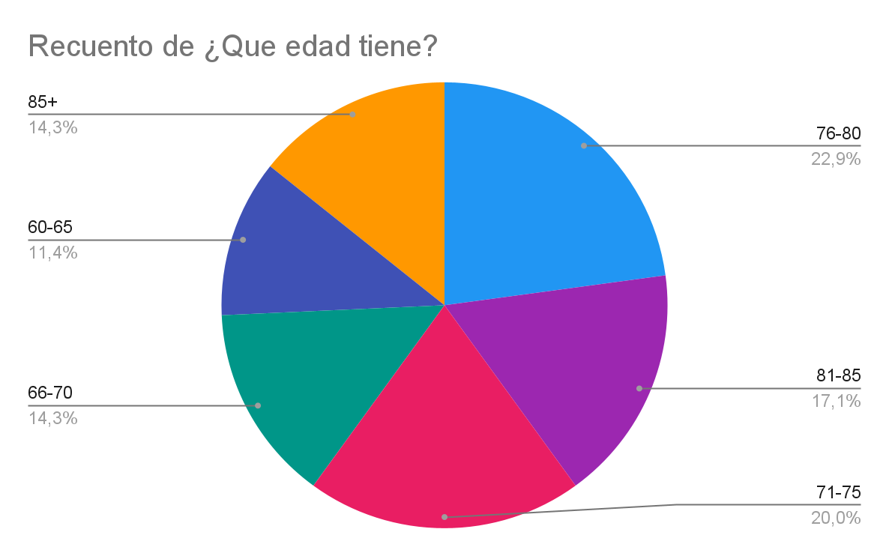

*Figure: Survey results for question 1, "How old are you?".*

> **Text in the image (English translation):**
> Title: Count of "How old are you?"
>
> | Answer | Share |
> | --- | --- |
> | 60-65 | 11.4% |
> | 66-70 | 14.3% |
> | 71-75 | 20.0% |
> | 76-80 | 22.9% |
> | 81-85 | 17.1% |
> | 85+ | 14.3% |

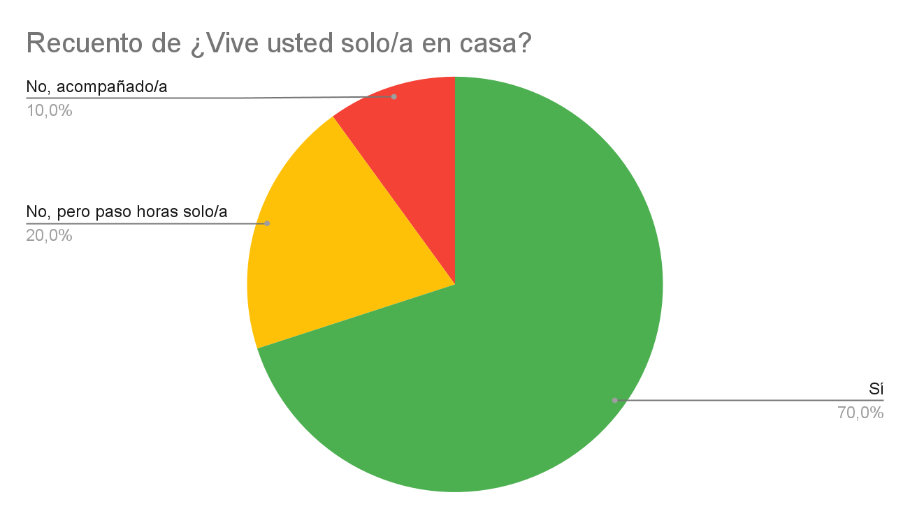

*Figure: Survey results for question 2, "Do you live alone at home?".*

> **Text in the image (English translation):**
> Title: Count of "Do you live alone at home?"
>
> | Answer | Share |
> | --- | --- |
> | Yes | 70.0% |
> | No, but I spend hours alone | 20.0% |
> | No, I have company | 10.0% |

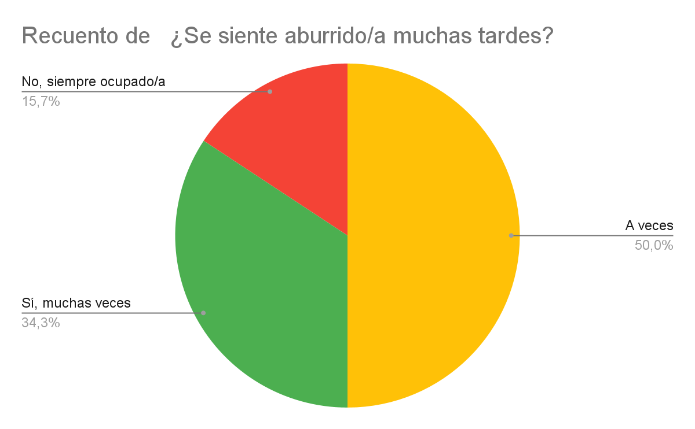

*Figure: Survey results for question 3, "Do you feel bored on many afternoons?".*

> **Text in the image (English translation):**
> Title: Count of "Do you feel bored on many afternoons?"
>
> | Answer | Share |
> | --- | --- |
> | Sometimes | 50.0% |
> | Yes, often | 34.3% |
> | No, always busy | 15.7% |

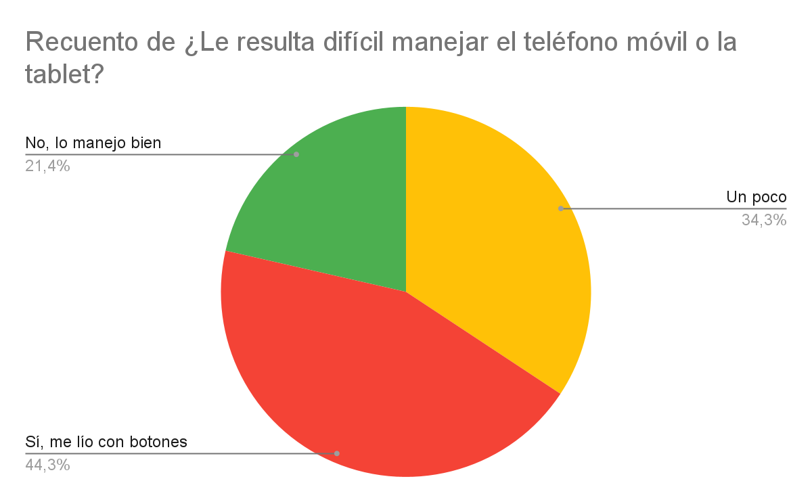

*Figure: Survey results for question 4, "Do you find it difficult to use a mobile phone or tablet?".*

> **Text in the image (English translation):**
> Title: Count of "Do you find it difficult to use a mobile phone or tablet?"
>
> | Answer | Share |
> | --- | --- |
> | Yes, I get muddled with buttons | 44.3% |
> | A little | 34.3% |
> | No, I manage it well | 21.4% |

<!-- PDF page 71 -->

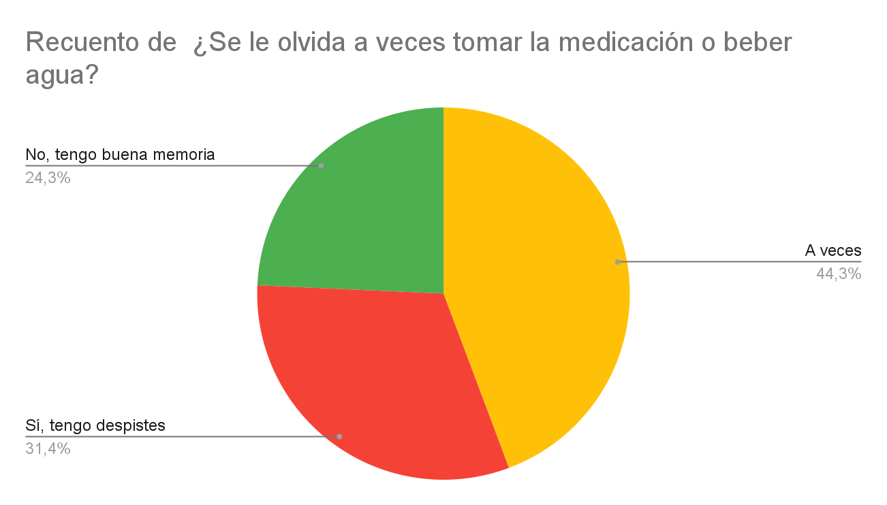

*Figure: Survey results for question 5, "Do you sometimes forget to take your medication or drink water?".*

> **Text in the image (English translation):**
> Title: Count of "Do you sometimes forget to take your medication or drink water?"
>
> | Answer | Share |
> | --- | --- |
> | Sometimes | 44.3% |
> | Yes, I'm absent-minded | 31.4% |
> | No, I have a good memory | 24.3% |

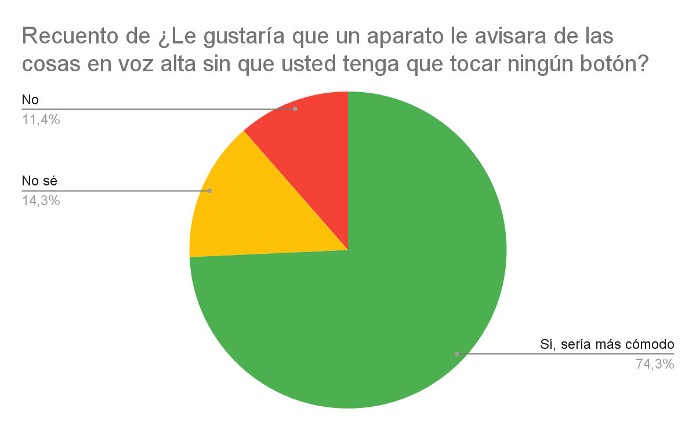

*Figure: Survey results for question 6, "Would you like a device to tell you things out loud without you having to touch any button?".*

> **Text in the image (English translation):**
> Title: Count of "Would you like a device to tell you things out loud without you having to touch any button?"
>
> | Answer | Share |
> | --- | --- |
> | Yes, it would be more convenient | 74.3% |
> | I don't know | 14.3% |
> | No | 11.4% |

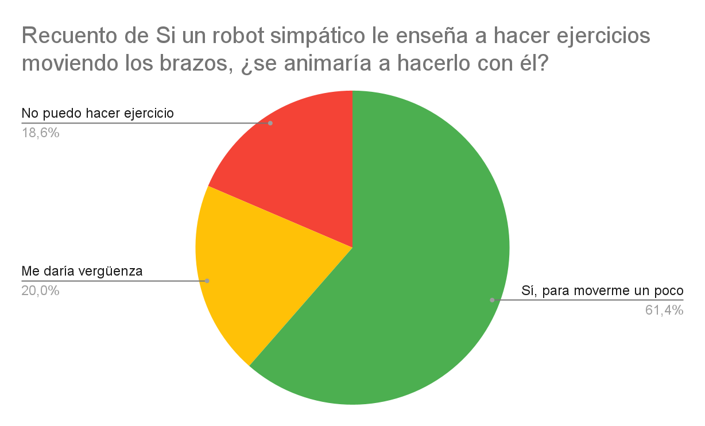

*Figure: Survey results for question 7, "If a friendly robot showed you how to do exercises moving your arms, would you be willing to do them with it?".*

> **Text in the image (English translation):**
> Title: Count of "If a friendly robot showed you how to do exercises moving your arms, would you be willing to do them with it?"
>
> | Answer | Share |
> | --- | --- |
> | Yes, to move about a bit | 61.4% |
> | I'd be embarrassed | 20.0% |
> | I can't exercise | 18.6% |

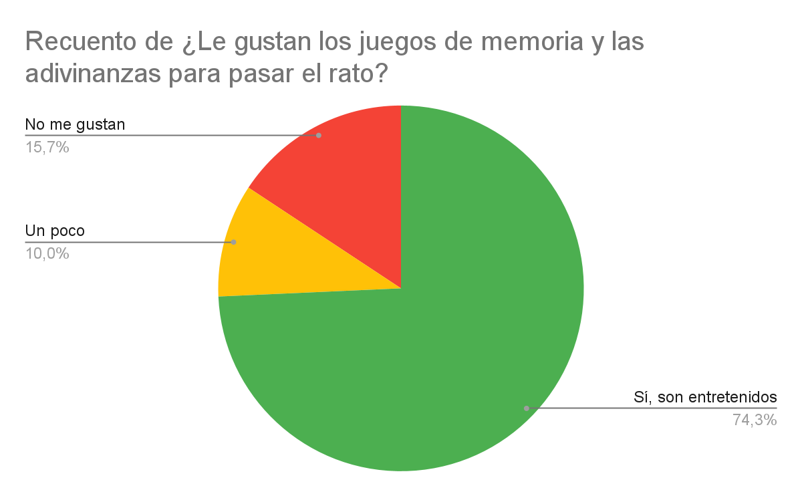

*Figure: Survey results for question 8, "Do you like memory games and riddles to pass the time?".*

> **Text in the image (English translation):**
> Title: Count of "Do you like memory games and riddles to pass the time?"
>
> | Answer | Share |
> | --- | --- |
> | Yes, they're entertaining | 74.3% |
> | I don't like them | 15.7% |
> | A little | 10.0% |

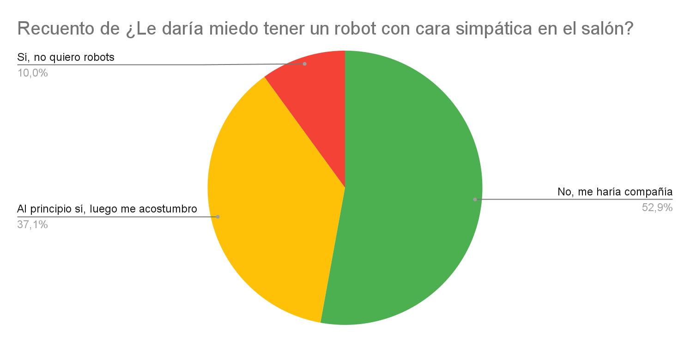

*Figure: Survey results for question 9, "Would having a robot with a friendly face in your living room scare you?".*

> **Text in the image (English translation):**
> Title: Count of "Would having a robot with a friendly face in your living room scare you?"
>
> | Answer | Share |
> | --- | --- |
> | No, it would keep me company | 52.9% |
> | At first yes, then I'd get used to it | 37.1% |
> | Yes, I don't want robots | 10.0% |

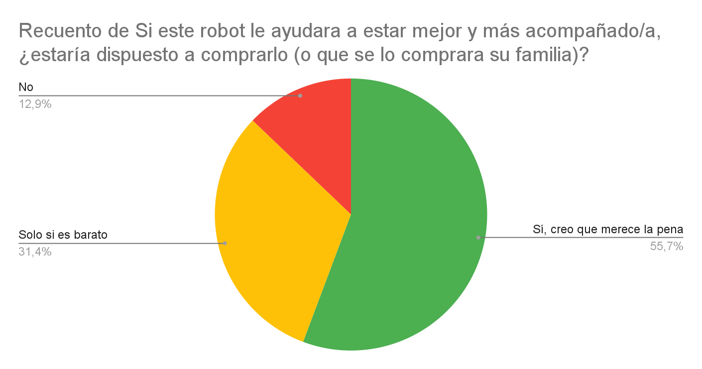

*Figure: Survey results for question 10, "If this robot helped you feel better and less alone, would you be willing to buy it (or have your family buy it for you)?".*

> **Text in the image (English translation):**
> Title: Count of "If this robot helped you feel better and less alone, would you be willing to buy it (or have your family buy it for you)?"
>
> | Answer | Share |
> | --- | --- |
> | Yes, I think it's worth it | 55.7% |
> | Only if it's cheap | 31.4% |
> | No | 12.9% |
